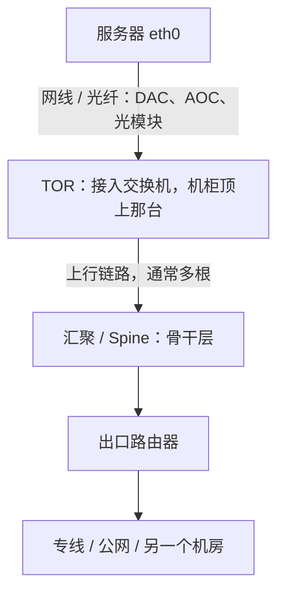

## 从一台机器走出去

把一台服务器当成起点，往外走五跳，你会依次遇到这些东西：

一个机柜通常 20~40 台服务器接到同一台 TOR 上。TOR 到上一层一般是 2~4 条上行，做链路聚合或者 ECMP。这套结构四五层就到头了，横向扩的是同层的设备数（几百台 TOR），层数不变。

记住这个形状，后面每一课都在其中某一段上做事。第 04 课在第一跳，第 12 课在 TOR 到 Spine 的多路径上，第 26 课把整张图自动发现出来，第 47 课沿着这五段做二分。

### 每一跳会怎么坏

| 位置 | 常见故障 | 观测手段 | 观测上长什么样 |
|---|---|---|---|
| 光模块 | 老化、污染、温度漂移 | 设备侧 DDM/DOM（SNMP OID） | 收光缓慢下降、误码上升、CRC 错包计数、时延缓慢抬升 |
| 网线 / DAC | 接触不良、弯折、没插到位 | 端口状态 + 错误计数 | 链路 flapping，计数器间断清零 |
| TOR 端口 | 队列溢出、单端口拥塞 | 计数器 + 主动探测 | 丢包集中在某一个端口、出口队列丢弃计数抬头 |
| 上行链路 | 一条 member 劣化 | 探测矩阵 + 逐流分布 | 聚合口整体正常，但按流分布会发现一部分流特别慢 |
| Spine / 出口 | 拥塞、路由震荡 | 全网探测、路由邻居状态 | 大范围、多机柜同时段抖动 |

**一个端口坏，影响几十个业务**；**一条上行坏，可能只有一个哈希桶里的流受影响**。后者最容易漏，因为它不触碰任何告警阈值。

表格第三列是这一行的关键。同一类故障，手里有没有观测手段，结局完全不同：光模块老化有 DDM 就能提前几周看见（第 06 课），手里没有这个数据就只能等端口 down；上行单成员劣化没有探测矩阵就永远发现不了（第 11、12 课），因为聚合口的状态一直是好的。

## 你自己的机房

把上面那张图换成你自己的，五个格子，各填一行。

| 层 | 设备型号 | 数量 | 管理面 | 能采什么 | 采不到什么 |
|---|---|---|---|---|---|
| 服务器网卡 | | | 主机 OS | | |
| TOR | | | 带外 IP | | |
| 上行 / Spine | | | | | |
| 出口 | | | | | |
| 外部（专线 / 对端） | | | | | |

填完会立刻出现三类空格，它们的处理方式完全不同：

1. **设备不在你手上**（出口、专线、对端机房）→ 只能靠对方给状态，或者从自己这一侧探测。第 25 课的跨机房专线就是这个情形
2. **设备在册但采集不通**（管理网隔离、ACL、只开了 SNMP v1）→ 先解决通路，再谈数据。第 17 课讲设备保护，第 08 课讲管理面可达性
3. **采不到的数据**（队列深度、buffer 使用、某条流的内部排队时长）→ 换手段：CLI 补采（第 45 课）、带内遥测（第 13 课），或者承认看不见

第三类最容易被忽略，因为「采不到」和「采到了正常」在图上长得一模一样。第 40 课讲的「缺失」形态，根子在这张表上。

## 数据可得性分三档

后端工程师最常犯的判断失误，是假设「设备上有的数据我都能拿到」。真实的可得性分三档：

- **好拿**：端口计数器（收发字节、错包、丢弃）、端口状态、光功率，SNMP 或者 gNMI 都能读，分钟级
- **要费劲**：队列深度、ECN 标记数、每条链路的逐跳时延，得靠新一点的设备能力和更细的采集频率
- **拿不到**：某一条流的内部排队时长（除非设备支持带内遥测）、已经飞过去的包

三条死路值得单独点出来，几乎每个团队都撞过一次：

**死路一：LLDP 没人开。**拓扑自动发现全靠它，而它默认经常是关的。拓扑往往是逐台配置出来的，跟「采一遍就有」差得远。第 26 课的融合策略里，MAC 反推只用来给「LLDP 关闭的老设备」打问号。

**死路二：设备只肯开 SNMP v1。**v1 没有 GetBulk，一次取一个 OID，遍历 `ifTable` 要几千次往返。48 口设备的全表轮询从 2 秒变成 40 秒，一万台设备直接压垮采集器。第 16、17 课讲这件事的两个后果：按列走、按档限流。

**死路三：管理网与业务网隔离，带外通道也断了。**设备失联时你既 ping 不到，也没有别的通道能进去，只能派人去机房。第 24 课把「带外管理 IP」列为台账的必须项，就是这一条交的学费。

## 第三种手段：自己发包

设备上的数据有边界，于是有了主动测量：在服务器 A 上装个探针，往服务器 B 发探测包，量的就是端到端。全机房铺满叫 PingMesh，按五元组打散能覆盖 ECMP 的不同路径。这是第二部分（10–15 课）的主题。

主动测量补的是「设备不告诉你」的那一段：

| 你想知道的 | 设备能给吗 | 主动测量能给吗 |
|---|---|---|
| 这个口 down 了没有 | 能（SNMP、Trap） | 不能（它不知道端口） |
| 这两个 IP 之间现在快不快 | 不能 | 能 |
| 走的哪一条 ECMP 分支 | 不能（除非开 INT） | 能（换源端口去撞） |
| 中间哪一跳慢 | 不能 | 部分能（traceroute 逐跳，第 43 课） |
| 某条流的排队时长 | 极少数设备能 | 不能 |

## 算你自己的链路数

地图上能看见的东西，决定了你的平台多大。这笔账现在就能算，两分钟。

假设你的机房 20 个机柜，一柜一台 TOR，每台 TOR 4 条上行：

| 项 | 算式 | 结果 |
|---|---|---|
| 物理链路 | 20 × 4 | 80 条 |
| 探测任务 | 80 × 2（双向） | 160 个 |
| 包量 | 160 ÷ 5 秒 | 32 包/秒 |

32 pps 是「理论全探」的量，任何一台服务器都扛得住。小机房的探测成本可以忽略，需要操心的只有覆盖率——同机架不探（服务器之间互访走 TOR 内部）、上行必探、跨层按权重抽样，第 11 课给这三条规则。

存储也顺手算一遍，按明细口径（每包一行，150 字节）：

| 项 | 算式 | 结果 |
|---|---|---|
| 写入 | 32 × 150 B | 4.8 KB/s |
| 一天 | 4.8 KB/s × 86,400 | 415 MB |
| 30 天 | 415 MB × 30 | 12.4 GB |

12.4 GB 的 30 天明细，这就是一个小机房「能举证」的全部存储代价。第 35 课那套 TB 级的账是给万台设备准备的，你的机房可能连一台单机 PostgreSQL 都用不满。

规模化之后数字会变：应探链路涨到 19.4 万条，包量到 7.8 万 pps，明细一天 1 TB。量级变化带来的不只是成本，还有一堆新的失败模式（第 30–35 课）。你需要记住的是**结构**，数字换成自己的链路数就能重算一遍——附录 C 给了全套公式。

## 拓扑为什么必须进数据模型

一张「设备-端口-链路」的关系表看起来枯燥，缺了它，后面所有事都做不成：

- 告警了某条链路，要能答出**影响哪些业务**
- 某个业务报慢，要能答出**要查哪几段**
- 一台设备要割接，要能答出**提前通知谁**
- 一个端口 down，要能答出**对端是谁、它是 up 还是 down**（第 04 课那棵判定树的最后一个叶子）

很多团队的可观测系统止步于「能看图」，卡的就是这一步：图上有数据，但数据不知道为什么在一起。

关系表还有一个隐性作用：它决定了哪些判断**根本写不出来**。端口不成对挂到链路上，「本端 up、对端 down」这句话在代码里无从表达；设备没有业务归属字段，影响面分析只能报出「一台交换机坏了」。第 25 课把这叫「模型错了后面全错」，这是全书出现次数最多的一句警告。

## 判据

读完这一课，你应该能回答三个问题。

1. 画出你自己机房的五跳图，每一跳标出「能采什么、采不到什么」。至少标出两处「采不到」。
2. 用你自己的机柜数与上行数算出包量，再算 30 天明细的存储。与你当前的采集系统实际占用比一比，差在哪里？
3. 挑一条你熟悉的链路故障，说明它落在五跳的哪一跳、用哪个观测手段能最早发现、那个手段现在有没有。

验收标准：第一问的「采不到」必须具体到数据项（例如「队列深度」「逐跳时延」），不能写「数据不全」；第二问要出现两个数（pps 与 GB），并解释差异来自覆盖率还是采集周期；第三问要指出「最早发现」与「当前能不能发现」的差距。

::: details 参考

1. 典型答案：服务器网卡能采（ethtool），TOR 端口能采（SNMP），光功率能采（DDM），队列深度多半采不到，Spine 的逐跳时延采不到（除非有 INT）。
2. 20 柜 × 4 上行 → 32 pps → 415 MB/天 → 30 天 12.4 GB。实际占用往往偏大，因为采集了全端口计数器（不止探测链路），且保留期更长。
3. 例如光模块劣化：最早信号是收光下降（第 06 课），现在多半只能等端口 down 才知道——差别就是几周的提前量。

:::

## 配套实验

本课无实验。地图这一课要的是一张手绘的现场图，`labs/` 里没有对应的东西可跑——第一份能跑的代码在 [`labs/00-setup`](https://github.com/lerixhe/idc-network-observability/tree/main/labs/00-setup)，探测矩阵的仿真在 11 课之后。

## 小结

一个 IDC 五跳到出口，故障点分布在这五跳上。每一跳的「观测手段」列决定了你能提前多久发现它。

数据可得性分三档，三档底下各有死路：LLDP 没人开、只有 SNMP v1、带外被隔离。

能看见的东西决定平台多大。20 柜 4 上行就是 32 pps、12.4 GB/30 天，一台服务器的事；规模上去之后变的是失败模式，结构还是这五跳。

拓扑是让这些数据产生因果关系的骨架。它还有一个隐性作用：决定了哪些判断在代码里根本写不出来。

下一课先看你的用户：网络运维的一天怎么过，他们拿什么凑答案。

## 思考

1. 你机房里的「死路」是哪一条？解决它要花的是钱、权限，还是别人的排期？
2. 同机架两台服务器互访，物理路径走了几跳？这段路径上的故障，你的探测矩阵覆盖得到吗？
3. 只能先给五跳中的一跳装上完整观测，你选哪一跳？用「故障频次 × 影响面 ÷ 采集成本」算一遍再回答。
