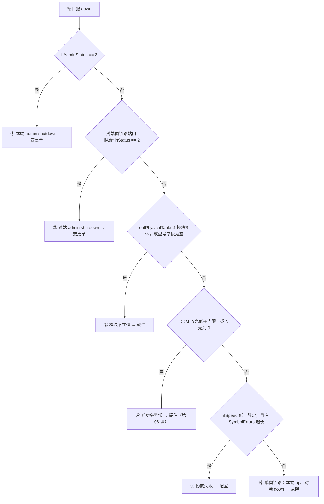

上一课把一个 `ifOperStatus` 送进九套系统，这一课停在第一站：一个口变成 down，是谁干的。

## 报表上两个 down，一个是变更一个是故障

周报上那个「端口 down 事件」数字，九成是割接。

`ifAdminStatus` 是人给的，`ifOperStatus` 是链路给的。两者都等于 2，报表上都写 down，含义差着一个工单类型。

| OID | 名字 | 谁改它 | 值 2 的意思 |
|---|---|---|---|
| `.1.3.6.1.2.1.2.2.1.7` | `ifAdminStatus` | 人敲 `shutdown`、配置下发、控制器推 | 有人主动关了这个口 |
| `.1.3.6.1.2.1.2.2.1.8` | `ifOperStatus` | 光模块、协商、对端、光纤 | 口开着，链路不通 |

混着统计的代价能算。某电商一周 412 条端口 down 事件，`ifAdminStatus=2` 的 371 条，占 90.0%；真故障 41 条。周报写「本周端口故障 412 次」，实际放大 10 倍（412 ÷ 41 = 10.05）。SLA 分母跟着错，季度考核跟着错，最后所有人都不看这个数。

再算一遍人力的账。每条变更类事件值班确认 2 分钟：371 × 2 = 742 分钟 = 12.4 小时，一周浪费 1.5 个人日。这 12.4 小时买到的结论只有一句——「这是变更」。

口径的第一件事是分开计数，精度随后再提。库里存两个字段的原文，对外至少分三档：admin 关闭、链路故障、状态待定。

三档里最容易被放过的是「admin 关闭且查不到变更单」。它有单独的价值：口是人关的，手续没走，属于配置漂移。这条落进变更类统计，等于替一次违规背书；落进故障类，又冤枉了链路。给它一个独立计数，第二周就会浮出几张没走流程的单子。

会失败的样子：报表把 admin 并进故障数，半年后团队只信自己的 Excel。数据全在，谁也不信，这是口径类故障最标准的失败方式，第 36 课还要回来算这笔账。

## 七个取值里，lowerLayerDown 是最贵的一条线索

`ifOperStatus` 有七个数，多数平台只认 1 和 2。

| 值 | 编号 | 含义 | 常见误判 |
|---|---|---|---|
| `up` | 1 | 本层可用，能转发 | 无 |
| `down` | 2 | 本层不可用 | 与 admin 混算 |
| `testing` | 3 | 人工测试态，环回、误码测试中 | 报成故障，实际是变更 |
| `unknown` | 4 | 设备自己也说不清，接口刚建、驱动异常 | 按 down 处理，放过设备侧根因 |
| `dormant` | 5 | 备用接口待命，等二层触发 | 报成 down，一台设备刷出几十条噪音 |
| `notPresent` | 6 | 这个 `ifIndex` 上没有硬件，模块拔了、板卡不在位 | 报成链路故障，派人去查光纤 |
| `lowerLayerDown` | 7 | 本层没起来，原因在下一层 | 归进 down，线索丢掉 |

前六个一眼能懂，第七个值得单独讲。

`lowerLayerDown` 的含义是「我这层没通，因为下面那层断了」。物理以太口很少返回它，逻辑口常见：VLAN 子接口、聚合逻辑口、隧道口。父接口 down，子接口就报 7。

它的价值在指方向。看到一个 7，修理对象就是这个口依赖的下层口。忽略它，工单会派给「子接口配置错」的人，实际要查的是父口的光模块——一次转派约 20 分钟，一天几十条，一个月十几个小时消耗在错误的队列里。

`notPresent` 同样被浪费。它是「模块不在位」的机器判据，比翻 `entPhysicalTable` 找实体快一步。读到 6 直接归硬件，不用再查光功率。

这个 6 也不是万能的。有些厂商在模块 EEPROM 读不出来时照样返回 2，实体表里那一格是空型号。所以 ③ 的判据要多一条保底规则：`entPhysicalTable` 里按 chassis → slot → port 的层级往下走，走到端口那一级没有模块实体，或型号、序列号字段为空，一律按模块问题处理。

`dormant` 与 `testing` 属于正常态，不该进故障池。带备份口的设备能靠这一条刷出几十条假告警，第 38 课的收敛规则再严格也救不回来。

存原文七值，采集侧不要折叠成布尔。

## 六种成因，一棵树走完

树的排序有两条规矩：判据便宜的先走，一次 Get 能定的先定；人干的事先摘出去，变更类占了九成。

同样六条落成一张表，右边两列是给人执行的部分。

| 成因 | 可测判据 | 归属 | 下一步 |
|---|---|---|---|
| ① 本端 admin shutdown | `ifAdminStatus=2` | 变更单 | 关联变更窗口，不派单 |
| ② 对端 admin shutdown | 本端 admin=1、oper=2；对端 admin=2 | 变更单 | 同上，对端设备写进影响面 |
| ③ 模块不在位 | `entPhysicalTable` 无实体，或型号字段为空 | 硬件 | 派换件单，附机柜 U 位 |
| ④ 光功率异常 | 收光低于模块门限，或为 0 | 硬件 | 同型号横向比对，看老化（第 06 课） |
| ⑤ 协商失败 | `ifSpeed` 与额定不符；`dot3StatsSymbolErrors` 持续增长 | 配置 | 查两端速率与双工配置 |
| ⑥ 单向链路 | 本端 oper=1、对端 oper=2；或两端收光差超过 10 dB | 故障 | 查光纤与两端模块收发 |

五号要看两种形态。一种是起不来，端口全程 down，`ifSpeed` 报 0，或报个远低于额定的数。另一种更隐蔽：端口起来了但降速，10G 协商到 1G；或者一端强制 100M 全双工、一端自协商落成半双工，端口 up，`dot3StatsSymbolErrors` 与 FCS 错误一路涨，业务表现为「通，但慢得说不清」。第二种在端口状态报表里是绿的，只能靠计数器抓。

六号只能靠比对两端。收发光走两根纤，一根断了，断的那侧收不到光，端口 down；另一侧照旧收到光，端口 up。物理上必然一端 up 一端 down，正好落在这棵树最后一个叶子。

判据也只有一条：拿两端状态做比对。所以端口必须先成对挂到链路上（第 25 课）。模型里端口是孤立对象，这个分支写不出来——模型错了后面全错，这是最典型的一处。

会失败的样子：平台只采本端。本端 up，报「正常」，对端已经 down 了三天。发现时机等于巡检周期，按周巡检算是最长 7 天。第 02 课那条被埋在 847 条告警里的单向链路，四天后被别的事情顺带查出来，同一个机制。

这条错误很常见：对端不在纳管清单里，于是被记成 unknown 就往下走了；两个月后同一根纤的反方向也断了，翻台账才发现那台对端一直在册，只是没挂链路。

## 树要能跑，缺的是这几个字段

判定树的输入分四组，缺一组就有分支走不通。

| 组 | 字段 | 缺了会怎样 |
|---|---|---|
| 本端状态 | `ifAdminStatus`、`ifOperStatus`、`ifLastChange`、`sysUpTime` | ①② 判不了，抖动去假也做不了（第 05 课） |
| 速率与错误 | `ifSpeed` / `ifHighSpeed`、`dot3StatsSymbolErrors`、FCS 错误 | ⑤ 只能靠猜 |
| 硬件与光学 | `entPhysicalTable` 的模块实体、DDM 收发光 | ③④ 判不出来 |
| 关系与上下文 | 链路对端端口、变更单窗口 | ②⑥ 写不出来，① 归不了类 |

输出必须是三元组：成因、归属、下一步动作。只输出一个 down，等于把判断又推回给人。

字段还有一个隐性要求：每个判据带采样时刻。两个源差 30 秒，结论就可能反过来，一份写着「本端 up、对端 up」而实际错开半分钟的记录，能把 ⑥ 判成正常。

时间字段单独说一句，因为它能把两个成因直接分开。`ifLastChange` 给出这个口最后一次变状态的时刻，把它和设备的起机时刻比：起机之后就没 up 过，这个口大概率是 ③ 或配置没下发；曾经 up 过又掉下来，才是事件型故障。一条判据省掉一整轮排查。

数据不全时按降级处理，不要硬判。拿不到对端，②⑥ 标注「未验证」，不要写成「未发生」；这两个词在事后复盘里差着一整天。

树还要留一个 unknown 分支。六类覆盖不到的情况一定有，落成「未判定」并附上已查过的判据清单，占比单独统计。这个比例连续两周在涨，说明缺第七种成因，不要硬塞进已有的六个叶子里。

四类归属分开计数，周报才有意义：变更、硬件、配置、故障。四列加起来等于 down 总数，不平衡就是树漏了分支。

判据齐了，还剩一类故障进不了树：端口没彻底 down，来回跳。下一课。

## 判据

读完这一课，你应该能对任意一条 down 记录给出三元组。下面三条先自己判，再看参考。

| 记录 | `ifAdminStatus` | `ifOperStatus` | 其他字段 |
|---|---|---|---|
| A | 1 | 2 | 对端 oper=2，对端 admin=2 |
| B | 1 | 7 | 父接口 oper=2，父接口收光 -31.4 dBm |
| C | 1 | 2 | 收光 -30.2 dBm，模块门限 -14 dBm，同型号其余 11 个模块 -6 至 -8 dBm |

验收标准三条：

1. 三条都判对成因编号，并且写出下一步动作由谁执行
2. 每条能指出哪个字段是判据、哪个字段只是旁证
3. 自己补一条树覆盖不到的真实记录，说明它为什么落在 unknown

::: details 参考

A → ②，对端 admin shutdown，归变更单。判据是对端 `ifAdminStatus=2`，本端 oper=2 只是结果。

B → 子接口 `lowerLayerDown` 只负责指路，根因在父接口：收光 -31.4 dBm 远低于 -14 dBm 门限，落 ④，归硬件。

C → ④，归硬件。判据是收光 -30.2 dBm 越限；同型号 11 个模块在 -6 至 -8 dBm，横向差 22 dB 以上，说明这一颗在快速劣化，链路预算解释不了（第 06 课）。

:::

## 小结

admin 与 oper 都报 down，前者是人干的，后者是链路干的。混着统计，周报数字放大十倍，团队从此不信平台。

七个取值里，`lowerLayerDown` 指方向，`notPresent` 省一步查表，`dormant` 与 `testing` 不该进故障池。存原文，不要折叠。

六种成因排成一棵树：先便宜的判据，先人干的活。四类归属分开计数，加一个 unknown 兜底。

单向链路只有一条检测路，两端比对。端口不成对挂链路，这棵树永远少最后一个叶子。

下一课看那类没断干净的故障：端口来回跳。

## 配套实验

[`labs/01-portstate`](https://github.com/lerixhe/idc-network-observability/tree/main/labs/01-portstate) —— 喂 20 个端口快照与 19 条 Trap，实现六成因判定树，输出成因、归属、下一步。样本埋了 admin shutdown 无光、单向链路两端结论不同、SNMP 代理重启的假抖动。

想自己写一遍判定树的，去 [`labs/exercises/01-portstate`](https://github.com/lerixhe/idc-network-observability/tree/main/labs/exercises/01-portstate) —— 同一个样本、同一份期望输出，只留一个函数给你填。

## 思考

1. 你平台上 `ifAdminStatus` 与 `ifOperStatus` 是分开存的，还是采集时折叠成了一个布尔？折叠之后还能补回来吗？
2. 一条链路两端都在纳管清单里，却没在模型里成对挂上，它的单向故障会被记成什么？
3. 把判定树的顺序换一下，让「模块不在位」排在「对端 admin shutdown」之前，代价是什么？
