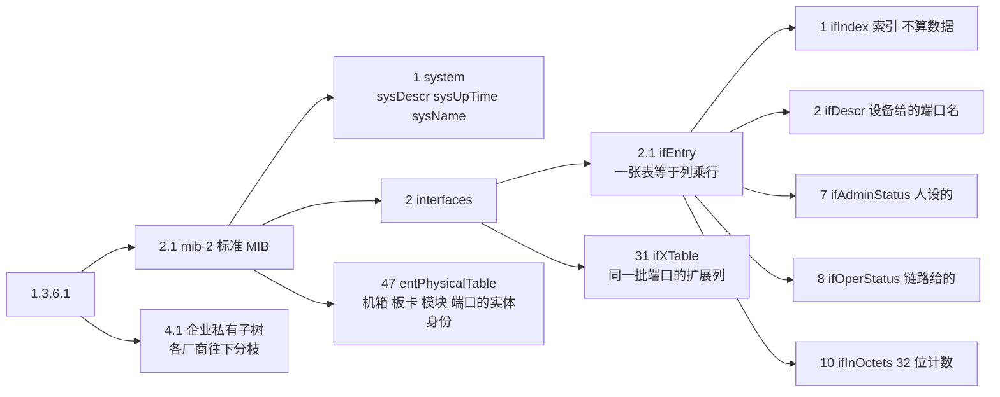

上一课把探针写到能上线，这一课换一侧：设备自己愿意说出来的那些数。

## 一个 OID 是从根走到叶的一条路径

`1.3.6.1.2.1` 这一串不用背，它是一条路径，每一段由上一级注册机构分配。厂商能自己起名的只有 `1.3.6.1.4.1` 以下那一段，申请一个私有号，再往下随便长。

记一个前缀就够开工：`1.3.6.1.2.1` 是 `mib-2`，标准定义全在这棵树里；`1.3.6.1.4.1` 以下是厂商地盘。看一个 OID 落在哪半棵，就知道它会不会随固件变、出问题该找谁。



叶子等于列 OID 加上索引。`ifOperStatus` 的第 24 行写作 `ifOperStatus.24`。标量的索引固定为 0，`sysUpTime.0` 结尾那个 `.0` 是标量表的唯一一行，省掉就取不到值。

遍历靠字典序。OID 逐段按数字比较，`ifOperStatus.9` 排在 `ifOperStatus.24` 前面——按段比，不比数值大小。GetNext 的语义就是「给我字典序的下一个 OID」，整张表的遍历顺序由此确定，跟你想先读哪一列无关。

## 标量一次 Get 拿到，表只能顺着走

| 操作 | 干什么 | 用在哪 | 代价 |
|---|---|---|---|
| Get | 精确点名一个 OID | 标量、已知索引的行 | 一行一次 |
| GetNext | 返回字典序的下一个 | 探边界、单条试探 | 一次一条，请求数等于 varbind 数 |
| GetBulk | 一次返回 M 个后继 | 表遍历的主角 | 响应可能超 MTU |
| Walk | 反复 GetBulk 直到离开前缀 | 一张表、一棵子树 | 请求数乘响应大小 |

「一张表要按列走」的具体含义在这里：行数是设备事实，你事先不知道。48 口还是 52 口、有没有子接口、堆叠多出几张表，全都得读出来才知道。所以构造不出一批 Get，只能给一个起点（`ifEntry` 的第一个叶子），然后一路读下一个。

字典序决定了这条路先走完 `ifIndex` 的 48 行，再走 `ifDescr` 的 48 行，再走第三列。**列是外层，行是内层**，跟关系库的行式读取正好反着。这就是列式遍历。

索引不一定只有一段。`ifEntry` 用 `ifIndex` 一段就够，ARP 表这类是复合索引：`ifIndex` 加地址，地址按「长度加字节」编号。复合索引的叶子长这样：`ipNetToMediaPhysAddress.<ifIndex>.<地址长度>.<地址字节…>`，v4 也带长度那一段。得先按索引顺序拼出完整后缀，才能 Get 某一行；拼错一段，设备回 `noSuchName`，或者回给你一条别人的数据（前缀恰好命中时）。工程上一般只走不复用——拼索引的代码很容易在地址长度上出错，而 walk 拿到的顺序本来就是对的。

两张表能 join 全靠索引同源。`ifTable` 与 `ifXTable` 是同一批端口的两种视图，共用 `ifIndex` 作索引，所以一轮里分别 walk 完，按 `ifIndex` 拼成一行 40 列。这也是为什么 `ifIndex` 一漂移，两张表一起漂移——它们绑在同一条索引上。

一台 48 口交换机走一遍的账：

| 项 | 算式 | 结果 |
|---|---|---|
| `ifTable` | 22 列 × 48 口 | ≈ 1056 varbind |
| `ifXTable` | 18 列 × 48 口 | ≈ 864 varbind |
| 一轮合计 | 1056 + 864 | ≈ 1920 varbind |
| GetNext 请求数 | 一个 varbind 一个请求 | 1920 个请求 |
| GetNext 报文量 | 1920 × 180 B | ≈ 346 KB |
| GetBulk 请求数 | 1920 ÷ 25 = 76.8，向上取整 | 77 个请求 |
| GetBulk 单响应 | 25 × 30 B 加报文头 | ≈ 850 B |
| GetBulk 报文量 | 77 × 850 B | ≈ 65 KB |

25 倍的请求数差，5 倍的报文量差。GetBulk 省的不只是次数：一个 GetNext 响应里 IP、UDP、SNMP 头和 OID 前缀占掉八成，一个 4 字节的值跟着 80 字节的包装走。

max-repetitions 不能往大了填。上限由 MTU 反推：1400 ÷ 30（一个 varbind 摊到的字节）≈ 46，取 25 留余量。填 200 的响应必然超 MTU，走到 IP 分片，丢一片整包重来；agent 还得先把 200 个 varbind 全构造出来才开始发第一个字节，CPU 尖峰被你自己拉得更尖（第 17 课算这笔）。

一处真实会咬人的边界：走到子树末尾，GetBulk 不会停，它继续给你相邻子树的下一条 OID，agent 不知道你想在哪收手。终止条件只有一个：返回的 OID 不再以本次前缀开头。拿「返回为空」当终点，后面几张表会被一起拖进来，一次轮询多读几千个 varbind，然后全部丢掉。

拿 walk 取标量是另一种浪费。有人把 `mib-2` 整棵走一遍只为拿 `sysUpTime`：第 02 课那台核心交换机的 FDB 有三十万条，就长在这棵子树里，按 25 条一批要一万两千个请求。取一个标量，用 Get，一个请求。

## ifIndex 当主键，三个月后曲线接到别人身上

`ifIndex` 是设备给自己的端口编的号，唯一性只存在于「此刻这台设备上」。换板卡、调槽位、堆叠加成员、固件大版本升级，都可能重排。

2021 年一批 24 口 TOR 换成 48 口，堆叠从两台变四台。设备名没变，管理 IP 没变，`sysObjectID` 也没变，变的只有 `ifIndex` 和端口名。采集器按时序键 `(device_id, if_index)` 写点，重启那一夜起，`ifIndex=12` 指向的口从「接一组存储服务器」变成了「万兆上联」。

后果分三段。

第一段当夜就来了：存储口原来的曲线是 3 Mbps，上联口是 900 Mbps。那条曲线在 02:14 之后跳了一个数量级，值班的人判定为上联链路劣化，开了一张查光模块的工单，查了两天，收光正常。

第二段更难发现：一周后重排稳定下来，两个机柜的端口开始**互换**曲线，两条曲线的量级都落在正常区间里。曲线还在画，平滑，无告警。这类错法没有任何自证的迹象。

第三段在季度末：容量台账取每口 95 分位做聚合，一台设备 48 个数里 14 个是别人的口，据此给两个机柜开了升级单。

翻出来的入口是第 06 课那套横向对比：同一批 12 颗模块，收光排名突然不乱序了——因为一组读数被接到了另一个槽位。加上业务方问了一句「这个口的曲线怎么跟隔壁 A3F-08 的一样」。

代价写清：三个月的曲线整段不可用——错一天还能回补，错三个月只能重采。两张误开工单，一张错开的升级单。修的时候无法回填——历史按 `ifIndex` 写的点，你不知道每个点当时属于哪个口，那台设备的 `ifName` 快照也没存。

映射表要长成这样，一行是「某设备上某个端口在某段时间叫什么」：

```sql
CREATE TABLE port_identity (
  device_id  TEXT        NOT NULL,   -- CMDB 主键，稳定
  port_uid   TEXT        NOT NULL,   -- 平台分配，永不复用；时序键用这个
  if_index   INT         NOT NULL,   -- 本地索引，只用来定位这一轮的数据
  if_name    TEXT        NOT NULL,   -- 解析键：Ge0/0/12、xe-0/0/0
  if_alias   TEXT,                   -- 人写的：到 A3F-07-STOR-01
  valid_from TIMESTAMPTZ NOT NULL,
  valid_to   TIMESTAMPTZ,            -- NULL = 当前有效
  PRIMARY KEY (device_id, if_index, valid_from)
);
```

四条规矩，缺一条这张表就退化回 `ifIndex`：

1. 时序点的键只认 `port_uid`。换板卡那天 `port_uid` 不变，曲线连续；真的换了端口，`port_uid` 换新的，曲线断开——断开是对的，接错才是灾难。
2. 每轮 walk 顺手带上 `ifName`（`ifXTable`）与 `ifDescr`（`ifTable`），一个用于解析，一个用于对照。只采计数器不采名字，等于每轮都在丢身份证。
3. 每轮比一次 `if_index → if_name` 与上一轮是否一致，不一致就发一条「索引漂移」事件，本轮的时序点先落暂存区，解析成功才入库。
4. 解析不出（新索引第一次见、`ifName` 变了、一台设备上 `ifName` 重复）一律进 `unresolved` 表，不入时序。宁可缺一段，不要接错对象。

`valid_to` 只封口不删行。历史查询按观测时间 join「当时有效」的那一行，这既是曲线能对上的前提，也是第 25 课端口成对挂链路的输入。

## 同一件事在三个地方，单位还不一样

标准 MIB、厂商在标准表后面追加列、厂商私有一整套表——同一个语义常常三份都有，读数还能不一致。

光功率最典型：标准里没有 DDM 那一组，第 06 课只能写家族名，因为 `entPhysical*` 给身份不给读数。队列深度、缓存占用、单板温度也一样，标准里查不到，各家自己填。

单位是第二处陷阱，比语义分裂更阴，因为它不报错，只是数错：

| 量 | 标准写法 | 常见错法 |
|---|---|---|
| 端口速率 | `ifSpeed` 是 bit/s（32 位），`ifHighSpeed` 是 Mbit/s | 10G 口两者对不上，`ifSpeed` 溢出后不报错（第 18 课） |
| 字节计数 | `ifInOctets` 32 位，`ifHCInOctets` 64 位 | 两套并存，采到 32 位那套就得处理回绕（第 18 课） |
| 温度 | 摄氏度整数 | 有的毫摄氏度，有的 0.5 ℃ 步长 |
| 光功率 | 标准无，厂商私有 dBm | 常按 0.01 dBm 存整数，读到 642 是 −6.42 dBm |
| 百分比 | 0–100 | 有的表用 0–10000 |

配一张单位字典，每个 OID 家族一行：`(family, unit, scale, signed, counter_bits)`，入库前统一换算。字典没有的家族不许入库，宁可报「未定义单位」——第 36 课那场口径分裂，一半是从这里开始的。

一条工程约束收尾：MIB 文件当文档用，别当依赖。厂商 MIB 常常要签 NDA，官网文件与固件版本对不上，编译器和你的解析库互相不认。采集器只认 OID 与列号，`ifTable` 第 8 列就是 `ifOperStatus`，这个位置由 RFC 固定；符号名从哪来不重要。

## 判据

三题，各写三行。

1. 一台 48 口设备，只要 `ifOperStatus` 与 `ifHCInOctets` 两列，GetBulk 的 max-repetitions 填 25，请求数是多少？为什么不能填 200？
2. `.1.3.6.1.4.1.<厂商号>.2.3.1.4.12` 属于哪棵子树？谁定义语义？换固件会不会变？
3. 设备重启后 `ifIndex=12` 从存储口变成上联口，你的库里怎么体现？一轮采集内怎么发现？

验收标准三条：

1. 第一题答出 4 个请求（每列 48 ÷ 25 向上取整得 2，两列各 2 个），并说清每列的第二个响应会溢出到相邻子树，靠前缀收手；填 200 会让响应超 MTU 分片，且把 agent 的 CPU 尖峰拉高。
2. 第二题答出是企业私有子树，语义由厂商定，随固件变，不进判据；真要采就锁定固件版本，并做取值异常的兜底。
3. 第三题答出：按 `port_uid` 写的曲线不跳，`索引漂移` 事件会来；按 `if_index` 写曲线会跳，而且不可回填。

::: details 参考

第一题：每列的第二个响应里 23 条属于本列（48 − 25），剩下的几条是字典序的下一条 OID。前缀判断写错，这几条会被当成 `ifHCInOctets` 的数据写进去，值是别的表的。

第三题的检测点只有一个：每轮比 `if_index → if_name`。没有名字列的设备（极老的 agent 连 `ifName` 都不给）退到 `ifDescr`，仍然拿不到就落 `unresolved`，别猜。

:::

## 小结

OID 是树上的坐标，前四段定归属，叶子等于列加索引。标量用 Get，表只能顺着字典序走，列在外层、行在内层。1920 个 varbind 用 GetNext 要 1920 个请求，用 GetBulk 25 条一批降到 77 个，报文量差 5 倍。

`ifIndex` 是本地索引，换板卡就重排。拿它当主键，曲线会安静地接到另一个端口上，三个月后连因果都能反着讲。主键是 `port_uid`，`ifIndex` 只用来定位这一轮的数据，`ifName` 用来解析，映射带有效期。

下一课换方向：把 1920 个 varbind 摊到几千台设备上，怎么采才不会把设备采到卡死。

## 配套实验

[`labs/06-snmp-walk`](https://github.com/lerixhe/idc-network-observability/tree/main/labs/06-snmp-walk) —— 内置 agent 按列遍历 `ifTable` 与 `ifXTable`。样本含一台响应慢、一台不可达、一台换板后 `ifIndex` 重排。

## 思考

1. 你们平台的时序键是 `(device_id, if_index)` 还是 `port_uid`？把换板卡那天的曲线调出来，你靠什么判断它接错了？
2. `ifAlias` 是人写的，人会写错也会留空。它该不该参与解析？给出分层：谁解析、谁展示、谁拿来报警。
3. 一台设备上 `ifName` 有重复（逻辑接口和物理接口各一套编号），你的映射表怎么区分这两种行？
