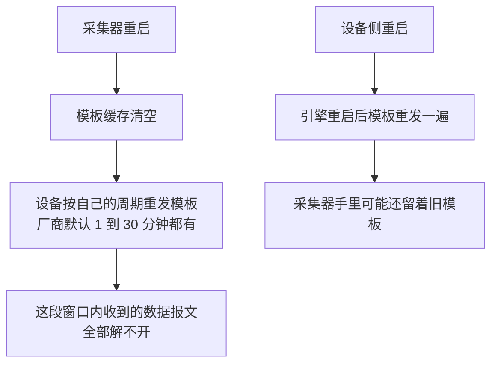

上一课算清了采样率定下的下限，这一课换到传输侧：那些样本怎么从设备走到库里，路上掉什么。

## UDP 丢一个包，丢的是一整秒的数据

流导出走 UDP，没有重传。这条事实在协议文档里只有五个字，落到数据上有一个具体形状：**丢的单位是时间块**，一秒的样本一起没有。

算一遍。100G 口 1:1000 采样，样本速率 12,500 条/秒，每条样本 200 字节。一条 1400 字节的导出报文能塞 6 条样本（1400 ÷ 200 = 7，留出报头，按 6 条算）。设备侧 socket 缓冲满，一次吐出来的就是这样一串：

| 项 | 算式 | 结果 |
|---|---|---|
| 样本速率 | 12,500 | 12,500 条/秒 |
| 每包样本 | 1400 ÷ 200，留出报头 | ≈ 6 条 |
| 每包覆盖时间 | 6 ÷ 12,500 | 0.48 毫秒 |
| 突发丢 2,000 包 | 12,000 条样本，12,000 ÷ 12,500 | ≈ 0.96 秒 |

0.1% 的随机丢包听起来无害：丢 10 条样本，TopN 顺序不变。真实网络里没有随机丢包这回事，UDP 的丢法永远成串：采集器 GC 卡了 800 毫秒，缓冲区溢出几千个包，那 0.96 秒的数据整段没有。曲线上的表现是一个洞，整体水平看不出变化。

补不回来。UDP 那头没有重传队列，导出源不留历史。唯一的补救是拿 SNMP 采的接口计数器反推总量（第 18 课）。总量补得回来，分布补不回来：这一秒里谁在打流量、哪个前缀占了七成，永久丢失。

再往下挖一层，有一个字段能直接量出缺口：IPFIX 报文头的序列号，累计该观测域发出的数据记录数。丢包在序列号上留跳变，比看曲线上的洞可靠——曲线上的洞也可能是真没流量。

提前说一个陷阱：NetFlow v9 的序列号记的是**导出报文数**，IPFIX 记的是**数据记录数**。两种口径不能混算，一个装 6 条样本的报文，在 v9 里加 1，在 IPFIX 里加 6。

## 模板没到，那段时间的数据是二进制垃圾

NetFlow v9 和 IPFIX 的数据报文不带字段名。报文里只有一串按模板排好的值，模板另外发：哪几个字节是源 IP，哪几个是字节数，哪几个是时间戳。

采集器必须先收到模板，才能解后面的数据。这条依赖在部署当天就会被撞一次：



**旧模板比没有模板更危险**：模板 ID 是设备本地分配的，重启后同号模板可能换了一套字段布局，采集器按旧布局去解，出来的数字全合法、全错——把字节数读成包数，链路带宽看着掉一个数量级，还查不出哪一步坏的。

所以模板缓存要带 TTL。多数实现取刷新周期的 3 倍：设备 10 分钟发一次，缓存 30 分钟作废。作废之后收到的数据一律丢弃并计数，不进库。

IPFIX 允许设备显式撤销模板（template withdrawal），收到就立刻删缓存。这个机制救不了丢包——撤销报文本身也是 UDP，一样会丢。

**模板缺失率**是这一课最该上监控的一个数：找不到模板而丢弃的数据报文数 ÷ 收到的数据报文总数。分母取报文数。换成字节，结果会被大报文稀释，看不出问题。

会失败的样子：某台设备的流采集进程被一次配置变更顺手停掉，24 分钟后恢复。这 24 分钟里三条链路的数据全空。平台上的表现是大盘一切正常——告警引擎对无数据的规则默认跳过评估，空值和「没有异常」在面板上长得一模一样。第 40 课把这类现象叫「缺失」形态，它是五种形态里唯一不报警的一种。

## 设备自己的钟，和你库里的时间差多远

流记录里有两个时间来源，都不能直接当真相用。

设备报的时间是它自己算的：`sysUptime` 是自开机起的毫秒数，绝对时间拿这块钟加上一个同步过一次的墙钟推出来。设备时钟偏几十秒是常态，没配 NTP 的偏几分钟。你把它和 SNMP 计数器曲线并排画，两条线错开半分钟，第一反应是「平台算错了」，其实是设备报的时刻就那样。

`sysUptime` 还有它自己的病：设备重启，它归零。用开机计时重建的时间序列会出现时间倒流——同一台设备的记录，后到的比先到的时间戳更早。第 46 课把五层时钟摊开讲过，流数据这一层属于最差的一档：基准来自导出源，精度来自设备那块钟，中间还夹一段聚合窗口。

能用的是三个差值，绝对值不可用：

| 比什么 | 怎么算 | 能告诉你什么 |
|---|---|---|
| 设备钟与采集器钟 | 记录里的绝对时间戳 − 采集器收到报文的时刻 − 单向时延 | 设备钟漂移了多少，秒级偏差看得见 |
| `sysUptime` 增量与接收时刻增量 | 两条序列各自求差再比 | 比值突变就是重启，比翻 syslog 快 |
| 流记录字节数与接口计数器 | 同一个 60 秒窗口内两个源的量对账（第 18 课） | 时间轴整体错位，错多少 |

第三条最实用，因为它不依赖任何一端的时间准，只用同一个窗口的两个量互校。

不要拿采集器的接收时刻当流时间。中间隔着设备的聚合窗口、导出批次、网络排队，晚几秒到几分钟都正常，晚多久没有规律。

## 一个 100G 口满速，导出多少

采量估算是这一篇唯一必须背下来的算术，它决定你后面买多少磁盘（第 35 课）。

| 项 | 算式 | 结果 |
|---|---|---|
| 端口字节速率 | 100 Gbit/s ÷ 8 | 12.5 GB/s |
| 包速率 | 12.5 GB/s ÷ 1000 B | ≈ 12.5 Mpps |
| 样本速率 | 12.5 Mpps ÷ 1000 | 12,500 条/秒 |
| 导出载荷 | 12,500 × 200 B | 2.5 MB/s = 20 Mbit/s |
| 加封装 | 每样本摊 50 B 的 UDP、IP、以太网头 | 3.1 MB/s |
| 一天 | 3.1 MB/s × 86,400 s | ≈ 270 GB |

一个满速口一天 270 GB，四十个这样的口一年 3.9 PB。采样已经把这事压到端口速率的 0.02%（20 Mbit/s ÷ 100 Gbit/s），剩下的 0.02% 依然是 PB 级工程。

聚合模式是另一套账，它不采样，按五元组全量收敛。记录数由两个量决定：

| 项 | 算式 | 结果 |
|---|---|---|
| 新流产生速率 | — | 10,000 条/秒 |
| 存量长流按 active timeout 切段 | 600,000 ÷ 1,800 | 333 条/秒 |
| 导出记录数 | 10,000 + 333 | 10,333 条/秒 |
| 导出载荷 | 10,333 × 64 B | 661 KB/s |

代入的口：每秒 1 万条新五元组，平均生命 60 秒，稳态并发 60 万条，active timeout 30 分钟。每条记录 64 字节，就是 661 KB/s，比采样模式还轻——NetFlow 因此敢做全量聚合，代价压在设备的 CPU 和内存上。

`active timeout` 与 `inactive timeout` 是设备侧两个老化参数，取值直接改写曲线形状：

| 参数 | 管什么 | 设太大 | 设太小 |
|---|---|---|---|
| active timeout | 长流到点强制切段导出 | 长流导出滞后，曲线右移；时间分辨率变粗 | 记录数暴涨，短流被切碎，设备 CPU 上去 |
| inactive timeout | 流静默多久判定结束 | 短流迟迟不出记录，十分钟前的突发现在才看见 | 有间隔的同一条流拆成多条，连接数虚高 |

「曲线右移」有个具体形状。active timeout 30 分钟，一条持续 40 分钟的大流量下载，第一条记录在流开始后 30 分钟才发出，带的是前 30 分钟的字节数。平台上看到的是：接口计数器曲线 14:00 起跳，流曲线 14:30 才起跳，两条线错开半小时，像一对猫眼。值班的人拿这两张图对账，会怀疑其中一个源坏了——两个都没坏，时间语义不同。

会失败的样子：active timeout 从 30 分钟调到 60 分钟，省设备 CPU，记录数掉一半，容量报表立刻好看。代价是所有长流延迟翻倍，微突发彻底看不见。第 21 课讲的小流叠加打满链路，在这套参数下永远查不出来。

## 四类可靠判断

前面几节分别留下了可观测的地方，落到日常就是四个检查，按「有没有源、解不解得开、收得全不全、断在哪一段」的顺序走。

它们的共同前提：**采不到和没流量在数据里长得一样**，靠曲线看不出来，只能靠元数据。

| 检查 | 指标与算法 | 阈值（起始值） | 异常时该干什么 |
|---|---|---|---|
| 导出源心跳 | 最近一次收到该源任意报文的时刻 | 超过 2 个模板刷新周期无报文（10 分钟刷新即 20 分钟） | 先确认设备管理面活着，再查流配置是否还在；接口有流量而流数据断，问题在采集侧 |
| 模板缺失率 | 无模板丢弃的报文数 ÷ 收到报文总数 | > 0 就该看；连续 10 分钟 > 5% 记数据缺口 | 查导出源刷新周期与采集器模板 TTL，两者比例控制在 3 倍以内 |
| 数据完整度 | 应收样本数（端口字节增量 ÷ 平均包长 ÷ 采样率）对比实收样本数 | < 95% 记缺口；< 80% 该时段禁止用于举证 | 查采集器内核丢包计数与 socket 缓冲，调大接收窗口，加多实例分流 |
| 时间连续性 | 序列号缺口率、`sysUptime` 归零次数、按设备时间轴的空桶数 | 缺口 > 1%/分钟；空桶连续 > 3 个 | 缺口查网络与采集器；归零查设备重启；空桶对 SNMP 计数器定性 |

四行里最容易糊过去的是完整度，因为它需要一个外部参照（第 18 课的接口计数器）。没有这个参照，你只知道「收到了多少」，不知道「应该收到多少」，缺 3% 和缺 30% 在报表上没有区别。

心跳那行有个反直觉的用法：心跳断了而接口计数器显示这段时间流量正常，是采集侧故障；心跳断了且接口也没流量，这段时间的数据是**真的空**，不该报故障，但心跳本身还是要报。第 03 课那张三层视角表讲的就是这个手法——单一数据源永远判断不了自己是缺了还是确实没有。

## 判据

下面是一份导出报文日志，读它，回答三个问题。

```text
09:02:11  源 10.9.4.1（观测域 3）首包，模板 256 收到
09:02–10:47  数据报文序列连续，seq 累计至 1,839,596
10:47:31  seq 1,839,596 → 1,849,196（跳 9,600）
10:47–11:06  序列连续，但模板 258 未收到，丢弃 55,860 个数据报文
11:06:02  模板 258 收到
11:06–11:52  序列连续
11:52–12:31  无任何报文
12:31:05  源 10.9.4.1 首包，sysUptime 412,300
```

这个观测域的稳态速率是 292 条记录/秒，每报文装 6 条，约 49 个数据报文/秒。全部数字按这个汇率对账。

验收标准三条：

1. 指出哪几段时间不可信，各由四类判断里的哪一类触发
2. 每段回答「能不能补回来」，补法是什么，补不回来的是什么
3. 说出 12:31 那个首包意味着什么，以及 11:52–12:31 这 39 分钟该不该报故障

::: details 参考

**10:47:31**：时间连续性触发。跳 9,600 条记录，按 292 条/秒算是 33 秒整段缺失，约 196 个导出报文。补不回来，因为 UDP 那头没有重传队列；总量可用接口计数器反推，分布和 TopN 永久丢失。

**10:47–11:06**：模板缺失率触发。19 分钟、1,140 秒 × 49 ≈ 55,860 个报文解不开，数据变二进制垃圾。这段既不能补，也不能猜——按模板反推字段是错上加错。缺口写进数据质量表，标记这一段「不可用」，也不能记成「零流量」。

**11:52–12:31**：心跳断 39 分钟。先看接口计数器这 39 分钟有没有字节：有，就是采集侧故障，数据补不回来；没有，就是真没流量，不报业务故障，但心跳本身仍要报出来。两个分支的处置完全不同，判据在流数据之外。

**12:31:05**：`sysUptime` 412,300 毫秒 ≈ 6.9 分钟，说明设备在 12:24 左右重启过。首包加归零两个信号合起来看，这 39 分钟里有 32 分钟设备根本不在。归零还意味着时间轴要分段：12:24 前后的记录不能直接拼成一条连续序列。

:::

## 小结

UDP 丢的是时间块。缓冲一满，掉的是整整一秒的样本，补得回总量，补不回分布。

模板不到，数据是二进制垃圾；旧模板比没有模板更坏，它解出合法的错数。分母用报文算，TTL 取刷新周期的 3 倍。

设备报的时间来自它自己那块钟，能用的是差值。`sysUptime` 归零，时间轴就得断开重接（第 46 课）。

一个满速口一天 270 GB，采样已经把它压到 0.02%。两个老化参数改写曲线形状，active timeout 太大，流曲线会比计数器慢半小时。

四类判断全盯元数据，一条也不看曲线——曲线分不清缺了和没有。数据可信了，下一个问题才是这些记录归属到哪个对象上：下一课从 CMDB 开始。

## 配套实验

[`labs/08-flow`](https://github.com/lerixhe/idc-network-observability/tree/main/labs/08-flow) —— 段级可信度判定与四级归因，UDP 无重传的后果在数据里长什么样。

## 思考

1. 你的采集器上，模板缺失率和丢包计数是各自暴露的指标，还是只有一句「采集正常」？
2. active timeout 从 30 分钟改成 5 分钟，记录数会涨多少？先算出倍数，再说设备能不能扛住。
3. 一道题给的是序列号连续而模板缺失，另一道是模板齐全而序列号跳变——两种缺口的处置优先级凭什么定？
