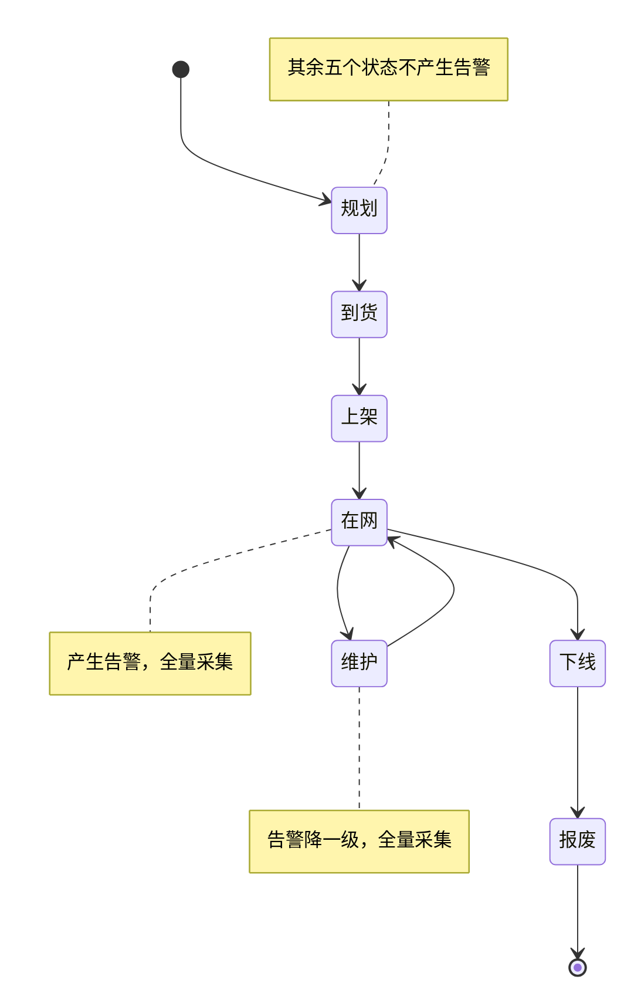

上一课把三种错法摊开，结论是名字不能当身份。这一课给一套扛得住改名的模型：五层对象、一条状态机、一道告警闸门。

## 五层对象，每层字段都挡着一类错

| 层 | 必须有 | 挡住的错 | 空了的后果 |
|---|---|---|---|
| 机房 | 位置、电力、网络区域、负责人 | 派单写「3 号楼附近」 | 影响面算不出楼级，定级靠猜 |
| 机架 | 编号、U 位、承重、上联 TOR | 现场找不到机器 | 终端定位终点丢失（第 27 课） |
| 设备 | 主机名、带外 IP、序列号、型号、固件、采购与维保日期、业务归属、责任人 | 身份与归属靠人记 | 影响面只能报「一台交换机坏了」 |
| 板卡 / 光模块 | 槽位、型号、序列号、插入时间 | 换件历史断档 | 光模块老化没有同批次可比（第 06 课） |
| 端口 | `ifName`、`ifAlias`、速率、介质、对端 | 主键选错 | 历史接错对象（第 23 课） |

五层照抄厂商的资产树会多出一堆用不上的格子。每一层的每个字段，都对应一次具体的派单或一次具体的误判，多一个字段多一份维护债，少一个字段就有一类工单写不下去。

机房一层里最值钱的是两栏。位置要精确到楼、层、房间，写「3 号楼」等于没写。网络区域分生产、存储、带外三张网，这一栏决定一台设备的管理面走哪条路——带外网段独立是后面所有远程修复的前提。

机架的上联 TOR 是拓扑的种子。缺它，一台 TOR 故障，平台算不出影响哪些机架，只能报设备级。

U 位与承重两列看着像给资产部门填的，判断影响面时要用。一个 42U 机架塞满 40 台 1U 服务器，加起来 800 kg 上下，承重上限常见 1,000 kg，再加两台存储就超了；这种机架一旦要扩容，先得算重量。U 位还决定一件事：同一机架内的设备共享同一对配电与同一台上联，一次断电牵动的是整个机架。

设备一层字段最多，留到下一节单独说。板卡与光模块的「序列号 + 插入时间」两列是给第 06 课准备的：光衰对比要按同型号同批次横着比，没有插入时间就分不出批次，一颗劣化模块会被同批次的正常值掩盖。

端口的 `ifAlias` 是唯一由人写给业务看的一栏。业务方报障时说的都是它——「接支付前置那个口」。这一栏为空，长链路排查里每一次沟通都要多问一句设备名和端口名。

## 带外管理 IP 必须有，序列号是唯一身份

两条字段规矩，违反哪一条都要付现场成本。

带外管理 IP 是设备失联时的唯一入口。管理 IP 配错、VLAN 打错、ACL 误封、配置刷掉，人进不去，只能走到机柜接 console。一次现场的成本：换鞋登记 5 分钟、走到机柜 10 分钟、找 console 线与笔记本 10 分钟、操作 20 分钟，合计 45 分钟。夜间还要两个人，算两小时。

一年 20 次现场，20 × 45 = 900 分钟，15 小时。其中 4 次发生在夜里，4 × 2 人 × 2 小时 = 16 人时。这些成本全部来自一个字段有没有录。带外 IP 还要独立建网：独立网段、独立 ACL、独立认证，管理面 CPU 打满时它仍在。

序列号是唯一身份，理由三条。主机名会改（第 23 课），IP 会复用，序列号出厂唯一且人改不动。

IP 复用在平台里的表现最像正常数据。同一个管理 IP 三年里换过三台设备，时序库里是一条连续曲线，带缓存、带峰谷、带周末低谷，没有一处断口。

序列号做身份也有代价，工程上要三条兜底：

1. 读到空串、`N/A`、`To be filled by O.E.M.` 一律不进主键，丢进异常队列
2. 两台设备报同一个序列号时，两台都进异常队列，不自动合并——合并错了污染的是主数据本身
3. 用「厂商 + 型号 + 序列号」三元组判重，单看序列号会被 ODM 撞号

`device_id` 可以是 `厂商:序列号` 的哈希，也可以是可读的 `dev-8f3a…`。要求只有一条：它不含主机名、不含 IP、不含机架号。

设备层还有两列容易被当成行政字段：固件版本和维保日期。固件版本决定一个已知 bug 扫得到多少台——某次缓冲区溢出只在 17.9.3 上发作，台账里这一列不准，只能全网盲猜。维保日期决定故障归哪类：保内走厂商换件，保外走采购，两条路的响应时间差一个数量级。这两列都能从设备自己报（`sysDescr`、`entPhysicalModelName`）加采购系统拼出来，不用人抄。

## 生命周期状态机：只有两个状态该响

| 状态 | 产生告警 | 采集 | 允许变更 | 典型错误 |
|---|---|---|---|---|
| 规划 | 否 | 无 | 否 | 提前进纳管清单，天天超时 |
| 到货 | 否 | 无 | 否 | 到货即转在网，测试流量触发告警 |
| 上架 | 否 | 只读探测 | 是 | 上线后忘转态，真故障被闸门挡掉 |
| 在网 | 是 | 全量 | 是 | 唯一的正常态 |
| 维护 | 是，降一级 | 全量 | 是 | 维护完没转回，长期漏报 |
| 下线 | 否 | 保留 7 天 | 否 | 配置未清，IP 复用后数据串台 |
| 报废 | 否 | 无 | 否 | 台账不删，就是第 23 课那 47 台 |

闸门的实现只有一行判断：`state in ('in_service', 'maintenance')` 才允许产生告警，其余全部丢弃并计数。

这道闸门比任何基线算法都有效，因为新设备前七天没有基线，静态阈值在业务割接时段每台能刷出一批。一批 40 台上架，按每台每天 12 条估，40 × 12 = 480 条/天；每条确认 45 秒，480 × 45 = 21,600 秒 = 6 小时/天。闸门把这 6 小时压到零，成本是一次主键查询。

维护态只降级，不豁免：端口 down 只进列表，设备失联照样叫人。人在重启设备，端口 down 是预期；设备失联超过维护窗口就是另一回事。

丢弃的那部分必须计数。`suppressed_by_state{state}` 这个指标连续两周为零，说明闸门没接上；突然涨十倍，说明有人批量改错了状态。没有计数的闸门，等于给告警加了一个静音键。

状态本身也要留历史。台账里只存当前值，加上一列 `state_changed_at` 和一张 `cmdb_state_history`（`device_id, from, to, actor, reason, ts`）。没有这两样，半年后有人问「这 12 台是什么时候出的在网」，答案只能在群里翻。搬迁、大批量割接、厂商换机之后，这张历史表是唯一能解释告警为何静默的地方。

## 闸门的两道接缝，每天能造几十条假事件

闸门挡假告警，也会挡真事件。接缝在两处，都是状态和现实不一致。

**新上架没转态。** 设备装好、通了、采得到，台账里还写着「上架」。它的端口 down 一条都不响。某次上线 40 台，人工点转态漏了 6 台，这 6 台第一周的真实故障全部没产生告警，一周后业务方投诉才发现。

修法是把转态做成自动判定，判据要机器可判：纳管成功 + 全部上联口 up + 连续 10 分钟采集无异常 → 转「在网」。写成「业务确认可用」就等于没写，人不会在周五下午点那个按钮。

**已下线没删台账。** 设备下架、台账状态没改，采集器照旧轮询。这一类每天造几十条假事件，跟第 09 课的上线/下线判定是同一件事的两面：第 09 课从探测侧判断设备在不在，这一课从台账侧判断该不该采。

两边不一致就出问题。探测说不在、台账说在，是僵尸；探测说在、台账说规划，是幽灵。两类都要每日对账，对账结果出差异单，不自动改台账（第 28 课）。

状态还有第三个接缝：**一台设备同时出现在两行台账上**。搬迁时机房变了，旧的没删，新录一行，于是同一台设备有两份数据，采集两份、告警两份、影响面算两遍。序列号唯一约束能在写入时就挡住它，这就是主键必须先定的理由。

## 字段责任：机器填设备报得出的，人填设备报不出的

| 字段组 | 谁维护 | 校核频率 | 怎么填 | 校核依据 |
|---|---|---|---|---|
| 身份：序列号、型号、固件、端口列表、光模块 | 采集器 | 每次采集 | 自动 | `entPhysicalTable` 双向比对 |
| 带外管理 IP | 网络运维开户时 | 每日 | 半自动，IPAM 分配 | ping + 配置对账 |
| 机房与机架位置 | 机房运维 | 上架时 | 人工 | 与上门工单核对 |
| 业务归属与责任人 | 业务方 + 变更单 | 每季度 | 人工 | 与发布系统主机清单比对 |
| 生命周期状态 | 值班 + 上架流程 | 事件驱动 | 半自动 | 与采集成功率反向核对 |
| 对端端口 | LLDP 自动 + 人工确认 | 小时级 | 自动 | 与人工台账出差异单（第 28 课） |

边界一句话：**设备自己能报的，机器填；设备报不出的，人填。**

序列号、型号、固件、端口表、光模块型号，出厂就带着，SNMP 一次 walk 全有，让人抄一遍只会抄错。业务归属、责任人、维护窗口、机架承重，任何协议都问不出来，只能人填。

最坏的做法是把人填的字段交给自动化去猜：按 IP 段猜业务归属、按机架号猜责任人。猜错一次，影响面分析就永久错一台，而且没人复核——那一栏看起来填满了。空字段会被发现，填错的字段不会。

三种填充方式要分开记：`source=auto|manual|derived`。有了这一列，采集覆盖率和字段准确率才分得开，季度校核才知道该找谁。

## 判据

给一份 40 台新设备的上线清单，写出四件事。

1. 每台设备的 `device_id` 由哪个字段生成，字段缺失时怎么办
2. 这 40 台在状态机上的完整路径，以及每一步由谁触发、判据是什么
3. 上线首周预计产生多少条告警，闸门过滤掉多少，过滤错的话代价是什么
4. 五层对象里哪一层的字段现在为空，空着会影响哪个下游功能

验收标准三条：`device_id` 不含名字与 IP；状态机每一步都有机器可判的判据；闸门有 `suppressed_by_state` 计数。

::: details 参考

第 1 题：`device_id = hash(厂商 + 型号 + 序列号)`。序列号读不到的设备先落异常队列，用临时 ID 挂着，不进正常采集池。用管理 IP 兜底是最差的选择，IP 复用会让两台设备共用一个 ID。

第 2 题：到货（收货人点）→ 上架（机房运维填 U 位）→ 在网（自动：纳管成功 + 上联口 up + 10 分钟采集无异常）→ 出问题进维护（值班点）→ 下线（变更单触发）→ 报废（资产流程触发，只标状态不删行）。

第 3 题：40 台 × 12 条/天 = 480 条/天，闸门全部挡住，同时挡住真实故障。代价是漏报，补偿手段靠自动转态，人工转态补不上。

第 4 题：通常是业务归属和带外 IP 两栏。前者让影响面只剩设备级，后者让失联设备只能现场修。

:::

## 小结

五层对象，每层字段都对应一次具体的派单。机房给位置，机架给 U 位与上联，设备给身份与归属，板卡给换件历史，端口给主键。

两条字段规矩：带外管理 IP 必须有，没有它设备失联就再也找不回来；序列号是唯一身份，主机名会改、IP 会复用。

状态机七个状态，只有「在网」和「维护」产生告警。这道闸门省下的是一天 6 小时的确认工时，代价是漏报，所以要配自动转态和 `suppressed_by_state` 计数。

两道接缝——新上架没转态、已下线没删台账——每天能造几十条假事件，两边都要每日对账，且不自动改台账。

下一课建链路：端口要成对，LAG 会逼着你把链路做成独立对象。

## 配套实验

[`labs/09-cmdb`](https://github.com/lerixhe/idc-network-observability/tree/main/labs/09-cmdb) —— 五层台账（机房/机架/设备/板卡/端口）与生命周期状态机，样本里有一批已报废但仍在轮询的设备。

## 思考

1. 你的台账里有没有一列能挡住「同一台设备出现两行」？如果没有，靠什么流程兜底？
2. 维护态只降级不豁免，这个选择在什么场景下会漏掉真故障？把场景写出来。
3. 自动填充的字段一旦填错，为什么比留空更危险？举一个你见过的例子。
