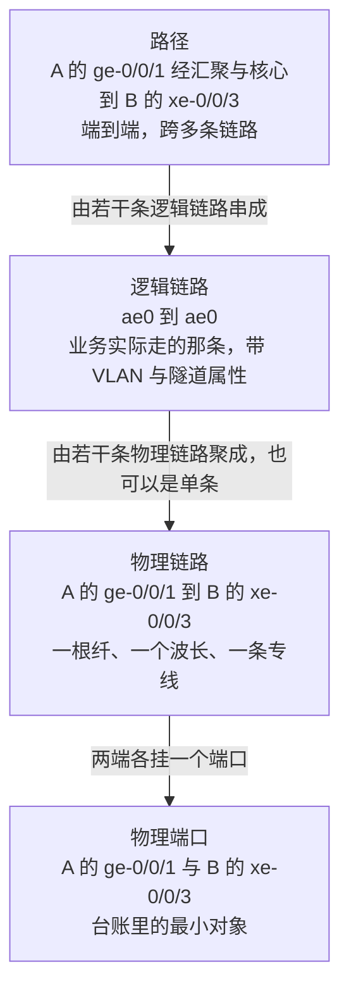

上一课把台账拆到端口，端口还各自孤零零挂着。这一课把它们两两接上——接不上，第 04 课那棵判定树最后一个叶子永远长不出来。

## 链路做成端口上的两个外键，第一次遇到 LAG 就得重构

最省事的一种建模：端口表加两列，`peer_device`、`peer_port`。48 口 × 2000 台 = 9.6 万行，一条 join 画得出图，看起来够用。

撑不过三个月。理由落在 LAG 上：四个成员口捆成一条逻辑链路，端口表里要写四行，四行的对端是同一条。于是三个问题立刻答不上来——这条链路带宽多少（四行各写 10G，还是 40G）、一个成员口 down 该报几条告警（四行各报一条，实际是同一次故障）、这条链路的 SLA 和故障历史挂在哪一行。

链路是独立对象：自己的 ID、带宽、两端端口（各是一个集合）、聚合关系、SLA、故障历史。压成端口的外键，LAG 一到就要重构，代价主要落在历史数据重挂——两百条链路三年的故障历史，重建一遍要两周，重建完还未必对得上。

六个字段，缺一个就有一类问题处理不了。

| 字段 | 为什么必须有 | 缺了会怎样 |
|---|---|---|
| 链路 ID | 告警指纹、SLA、故障历史全挂在它上面 | 用两端端口名拼 ID，设备改一次名历史断一次（第 23 课） |
| 两端端口集合 | LAG 是多对多关系 | 聚合链路只能记一个成员口，其余三个成孤儿 |
| 有效带宽 | 利用率必须有分母 | 4×10G 跑 30G 流量，分母写成 10G，利用率算成 300% |
| 聚合关系 | 成员口故障与逻辑口故障分级不同 | 4 个成员口 down 1 个，报 4 条告警 |
| SLA 与口径 | 举证包要给出承诺值 | 第 10 课的举证包缺最后一栏 |
| 故障历史 | 复盘、老化、同链路横向对比 | 每次从时序库现场拼，拼出来的时刻对不齐 |

链路 ID 单独说一句：它不能从端口名字派生。设备改名、端口重命名、换成另一批成员口，端口名全变，派生出来的 ID 跟着变，三年历史当场断成几段（第 23 课的第一个错法）。ID 生成时只吃两个不可变的东西：两端的设备序列号集合，加上创建序号。主机名、IP、端口名都只进展示层。

顺带一个副作用：ID 不派生，就能把「链路重建」和「链路换名」两件事分开。换一根纤但两端还是那两个口，ID 不变，故障历史连着；拆成两条新链路，ID 变，历史断开。这两件事在运维那里是完全不同的动作，库里必须分得开。

## 四层：端口、物理链路、逻辑链路、路径

四层各回答一个问题：端口回答「这个口亮不亮」，物理链路回答「这根纤通不通」，逻辑链路回答「业务这条路通不通」，路径回答「A 到 B 这一趟走哪儿、多快」。

路径层不一定要全建。一万台设备两两组合是五千万条，建出来九成永远不会被查询。做法是只建被探针覆盖的路径（第 11 课），一条路径就是探测矩阵里的一行，两边共用同一个 ID。省下来的不只是存储，最要紧的是「路径」这个词在举证包里能指到具体那一条——第 10 课要给业务方看的那条曲线，横坐标必须是一条有 ID 的路径，不能是「A 到 B 大概那条」。

链路对象也要跟着第 24 课的状态机走：规划、在网、维护、下线。只有「在网」和「维护」产生告警，其余状态照样存在，只是不叫醒人。这一条闸门放在链路上比放在端口上更省事——一条 LAG 下线，四个成员口一起静默，不用逐个关。

层间关系是**聚合**。一个端口可以同时属于多条链路：一条物理链路、一条 VLAN 逻辑链路、一条隧道路径。所以端口表里放不下 `link_id` 这种单值外键，得多一张关系表，一个端口 id 对多个链路 id，带上角色（成员、承载、端点）。

这四层各有各的用处。第 03 课那张三层视角表里，「端口状态」和「路径质量」两行差着的正是这两层——端口 up 说明物理层通，逻辑链路 down 说明业务不通，两者中间那一段有独立对象，才谈得上分别测量。

## 四种漏掉的形态，每一种都在出事之后才发现

四种形态的共同点：建图的时候看不出来，第一次故障时才暴露，而且暴露出来的样子长得像「数据不对」，没人会先怀疑模型缺了一层。

| 形态 | 模型上漏在哪 | 出错后果 | 最小修法 |
|---|---|---|---|
| LAG | 链路假设一对一两端 | 成员口 down 一个报 4 条；30G 流量按单口 10G 算，利用率 300% | 两端存端口集合，成员关系单独一张表 |
| 堆叠与跨设备聚合 | 链路的两端假设各一台设备 | 故障各报一半，影响面算漏一半 | 链路的「端」是设备集合 |
| 跨机房专线 | 以为两端设备看得见对方 | 传输段中断，两端都报 down，判成两条独立故障 | 链路允许有非纳管的中继段，带宽取合同值 |
| 逻辑链路 | 只建了物理层 | VLAN 未放通、隧道 down、MTU 不够，物理层全程 up | 逻辑链路单独一层，带 VLAN ID 与隧道端点 |

堆叠那条最值得展开。两台设备堆叠后逻辑上是一台，跨设备聚合的两端分别落在不同成员机上。查故障时你只看到「SW-B 的 ge-0/0/24 down」，而链路对象里这一端记的是「SW-A + SW-B」两台——记成一台，另一半端口就永远挂不上链路，那条成员口的 down 事件在拓扑里没有归属，只能落进「未知」桶。

LAG 的状态要按成员算成一个三态：全成员 up 记 up，部分 up 记降级，全 down 记 down。降级单独一档，因为它的处置完全不同——降级查那根断掉的纤和它的光模块，down 查整条链路两端。只存 up/down 两态，降级那一刻的样本会被下一次轮询抹成 up，冗余顶着业务，故障就一直挂着没人管。

跨机房专线要单独算一笔账。合同带宽 5G、两端各跑 10G 口，按端口速率算利用率，业务跑到 5G 时你已经超了合同，账面上还显示 50% 空闲。专线的分母是合同值，端口速率跟它没有关系。

逻辑链路这一类最隐蔽。VLAN 没放通，物理端口 up、光功率正常、误码为零，业务不通；VXLAN 隧道对端 VTEP 不可达，物理层全绿，overlay 全断。这两件事在物理层模型里根本没有位置，落到运维那儿只能登设备敲命令。

四种不必同时做。单机房、三百台以下的规模，堆叠和跨机房专线可以先空着，LAG 必须有——有堆叠的机房一定有用 LAG 的服务器双上联，没堆叠的机房一样有。做链路的顺序按「会不会算错数」排，不按「好不好看」排：带宽错会让利用率错，聚合关系错会让告警条数错，这两条错一次就没人再信那张图。

会失败的样子：拓扑图上一条 LAG 被画成四条并行链路。看起来只是「图难看」，实际后果是影响面分析连算四遍——同一台 TOR 掉线，报表上写「影响 4 条链路」，复盘的人以为动了四条，去查了三个小时的误操作。图错一次，后面所有基于拓扑的统计全错，而且错得像对的。

## 单向链路是这套模型的第一个验收用例

第 04 课第六种成因只能靠比对两端：本端 `operStatus=1`、对端 `operStatus=2`，或者两侧收光差超过 10 dB。这类故障占比不高，藏得最久——第 02 课那条被埋在 847 条告警里的单向链路，四天后才被别的事情顺带翻出来。

写得出这个判断，前提有三个：

1. 两个端口挂在同一条链路对象上，且这条链路的端点是端口集合
2. 两端样本的时刻差小于采集周期的三分之一（第 46 课），否则一端是 down 前的样本、一端是 down 后的样本，比出来的结论是假的
3. 比对时把 `ifAdminStatus` 一起带上，对端是人工 shutdown 的情况归变更单，不进故障池

第三条漏掉，台账上每次割接都会刷出一批「单向链路」。第二条漏掉，两个采集器差 5 秒就能造出一次假故障——一次 5 秒的状态翻转，被两次不同时刻的采样拼成了「本端 up、对端 down」。

聚合链路上的比对要下到成员口级。逻辑口 ae0 只会告诉你「还剩几条成员在扛」，成员口的成对关系才给得出「哪一根纤断了」。聚合链路的 `lowerLayerDown`（第 04 课的取值 7）指向的正是成员口，这条链一直通到底层，才谈得上定位。

两端的数据来源常常不对等。一端走 60 秒轮询，另一端由 Trap 驱动、秒级更新，两边的时间粒度差两个量级。拿这两个数直接比，会造出一批假单向：Trap 已经报了 down，轮询那一侧还是上一轮的 up。解法只有两条——要么统一落到同一个采样时刻再比，要么允许结论是「未知」并把它单独计数。猜成正常比报未知贵得多。

## 判据

读完这一课，你应该能给三条记录各写一个结论：成不成链、缺哪一层、下一步谁去做。

| 编号 | 记录 |
|---|---|
| A | ae0 有 4 个成员，ge-0/0/1 down，其余 3 个 up，ae0 oper=up，业务速率无变化 |
| B | SW-A 与 SW-B 堆叠成一台，跨设备聚合 MC-LAG1 的成员口 ge-0/0/24 在 SW-B 上 down，SW-A 侧无对应端口 |
| C | 专线两端端口都 up，业务不通，传输网管显示该段误码率 1e-4，两端设备互相看不见对方 |

验收标准三条：

1. 每条判出链路对象的层（物理 / 逻辑）、是否需要新建对象
2. 每条说清「模型不改的话，这条记录会落到哪儿」——落进未知桶、落成两条独立故障，还是干脆看不见
3. 自己补一条四层覆盖不到的真实形态，说明它为什么落在模型之外

::: details 参考

A → 物理层一条成员链路 down，逻辑链路降级但未断。修法：成员关系表里记 4 条成员、1 条 down，告警只报一条「LAG 降级 3/4」，别再单独报成员口。业务无感是因为还剩 3 条扛着，这正好是冗余的正常工作状态，不该叫醒人。

B → 堆叠形态，链路端是设备集合。修法：把 MC-LAG1 的两端各记成 {SW-A, SW-B}，成员口 down 落在 SW-B 上，另一端对应不到端口就标「跨设备成员」，不要留空当成数据缺失。

C → 专线形态，中间有非纳管中继段。模型里要有这一段，且状态只能来自传输网管，取不到 SNMP 值。两端设备都 up 是正常的，误码 1e-4 才是判据——只有端口状态的平台永远查不出这条记录。

:::

## 小结

链路是对象，有独立的 ID 与故障历史。六个字段缺一个就有一类问题处理不了，其中带宽和聚合关系最容易被当成果展示字段省掉。

四层：端口、物理链路、逻辑链路、路径。层间是聚合关系，一个端口同时在多条链路上，端口表里放不下单值外键。

四种形态——LAG、堆叠与跨设备聚合、跨机房专线、逻辑链路——出事之前都看不出来，出事之后表现成「数据不对」，看起来跟「模型缺层」毫无关系。

单向链路是这套模型的验收用例：端口不成对挂链路，第 04 课那棵树就少最后一个叶子。

下一课反过来问：这些链路是谁告诉你的。LLDP 凭什么可信，可信到什么程度。

## 配套实验

[`labs/09-cmdb`](https://github.com/lerixhe/idc-network-observability/tree/main/labs/09-cmdb) —— 端口成对挂到链路上的最小实现。做不对这一步，04 课判定树的最后一个叶子就永远长不出来。

## 思考

1. 你手上这套台账里，带宽字段记的是端口速率还是合同值？如果是前者，一条 4×10G 的 LAG 现在的利用率是多少，会不会曾经超过 100%。
2. 跨设备聚合的链路对象，两端各是一个设备集合。这样一个对象在告警指纹里怎么写，才能让「同一件事」在两边报出来时收敛成一条？
3. 逻辑链路这一层不做，MTU 类故障（隧道封装后 1500 字节的包过不去）在平台上是完全不可见的。这个盲区值不值得为它加一层？给出你的判据。
