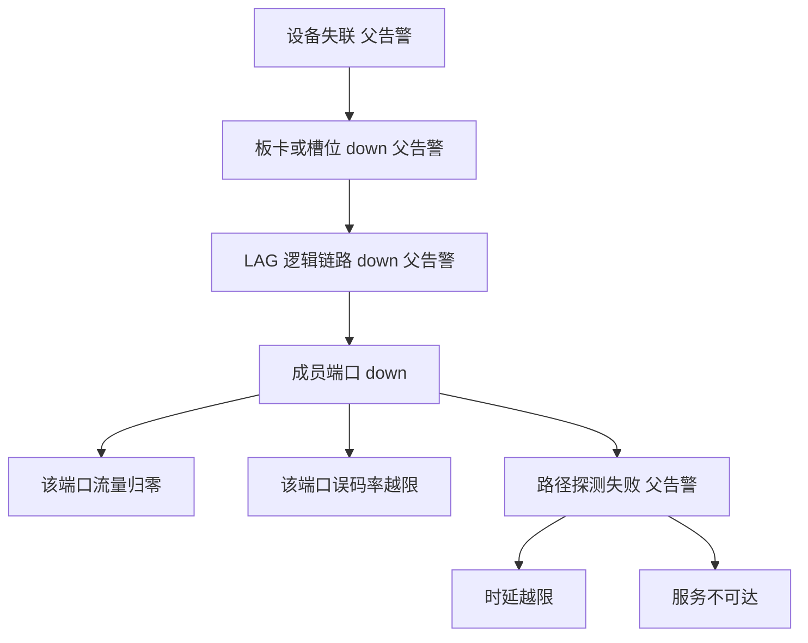

上一课把标签的账算完了，这一课给这批时序配上判读：什么该响、响的时候把哪些按住、按不住的时候怎么收成一条。

第 04 课那棵判定树回答「这一个口为什么断」。告警引擎回答另一个问题：一晚上 800 条，哪 3 条值得叫人。

## 一条端口 down 背后是一棵树

端口 down 从来不长成一条孤立的告警，它是叶子。往上三层，每层各有自己的父。



树干只有一个：某块板卡停了。第 08 课算过一台设备断电 49 条，第 02 课 11:30 那次是 847 条，同一棵树的两种规模。

把一次板卡重启的 4 小时窗口摊开，账是这样（12 台 TOR，每台 48 口，下挂 240 台服务器）：

| 类 | 条数 | 算式 |
|---|---|---|
| 上联端口 down | 24 | 12 台 × 2 个上行口 |
| LAG 逻辑口 down | 12 | 每台一条双成员聚合 |
| 路径探测失败 | 480 | 240 台服务器 × 2 个目标 |
| 探测时延越限 | 240 | 同一批服务器到近端目标 |
| 拨测服务不可达 | 40 | 40 个业务地址 |
| 误码与收光越限 | 4 | 4 个上联口 |
| 合计 | 800 | 24 + 12 + 480 + 240 + 40 + 4 |

800 是第 29 课去重之后的事件数，四源原始记录 2 880 条，收敛比 3.6。全推给人，加上恢复通知与短信重发，一晚上手机响两千次以上。值班的人只做了一件事：关掉声音。

看最后一列：树上位置最高的那条只有 1 条，位置最低的有 480 条。抑制的全部意义就是从这 480 条里把人捞出来。

## 规则引擎的最小集是五条

规则写得越多，可解释性掉得越快。留五类够用，第六类开始就是负债。

| 类型 | 表达 | 拿它抓什么 | 失败形态 |
|---|---|---|---|
| 阈值 | `v > X` | 有物理上限的量：带宽利用率、光功率、温度、会话数水位 | 峰谷不分，X 定在哪个数都错（第 39 课） |
| 持续时长 | 条件成立 ≥ T | 滤掉瞬时尖刺与单点抖动 | T 太长，短故障直接漏；T 太短，抖动全进来 |
| 变化率 | `Δv/Δt > Y` | 缓慢劣化：收光下降、误码爬升、队列丢弃抬头 | 计数器回绕算成负速率，重采算出假斜率（第 18 课） |
| 缺失 | 连续 N 个周期无数据 | 采集故障、探针掉线、设备失联 | 分不清「设备没数」与「采集器停止工作」（第 40 课） |
| 组合条件 | `A ∧ B ∧ ¬C` | 压误报的主力：链路 up 且误码在涨，同时排除变更窗口 | 表达力上去，没人能复述它为什么响 |

五类之上还有一个状态机，它独立于表达式：`pending → firing → resolved`。规则命中先进 `pending`，撑过 `for:` 才进 `firing`，恢复要连续 N 个周期才 `resolved`。

持续时长做在状态机里，别写成 `v > X for 5m` 这种表达式——表达式算不出「中途掉下去又起来」该怎么计时，而日志里一半的抖动都是这个形状。

一条硬判据：**任何一条告警，值班的人都要能用一句话复述它为什么响。** 复述不出来，规则就该删掉。

## 抑制表：父压制子，不反向

抑制得做成一张独立的表，别塞进规则里当一个开关。四列：父、子、方向、例外。

父子关系从对象图里取，三处外键拼出整棵树：CMDB 的设备 → 板卡 → 端口（第 24 课），链路的成员口 → 逻辑口（第 25 课），链路 → 路径（第 10 课）。抑制表只做一件事：给每条外键标上方向。

| 父 | 子 | 方向 | 例外（子仍要发） |
|---|---|---|---|
| 设备失联 | 该设备全部端口 down | 父压子 | 端口 down 早于失联 30 秒以上 |
| 设备失联 | 该设备的 CPU、温度、收光越限 | 父压子 | 无 |
| 板卡 / 槽位 down | 该槽位全部端口 | 父压子 | 同设备其他槽位也在 down |
| LAG 逻辑口 down | 成员口 down | 父压子 | up 的成员口数与 LAG 带宽对不上 |
| 端口 down | 该端口的流量、误码、探测失败 | 父压子 | 探测失败在端口 down 之前就成立 |
| 链路 down | 经该链路的路径失败 | 父压子 | 失败路径数超过该链路承载数 |
| 变更窗口 | 窗口内该设备的端口类告警 | 父压子 | 超出窗口边界 10 分钟；变更单未覆盖的对象 |

三条原则，每条都被违反过。

**方向单一。** 父压子，子永不压父。代码里只留一个方向的匹配函数，双向匹配是自找的。

**抑制只影响通知，不影响存储。** 被压的子告警照样落事件表，只是不进通知流。删数据来降噪，等于把复盘要的证据烧掉。

**抑制图必须是 DAG。** 堆叠、跨设备聚合、互为上游的专线都会造出环。环上的抑制互相吞掉，最后什么都不响。

父子关系缺失时，退化方案是时间窗关联：同设备名前缀 + 30 秒窗 + 同类事件 ≥ 5 条 → 猜一个共因，合并成一条。代价写在脸上：跨设备完全失效（12 台 TOR 名字各不相同），时间差超过 30 秒失效（板卡重启到端口状态被轮询到，最坏差一个轮询周期 300 秒），还会把两条真事并成一条。这套东西只配用在 CMDB 没建好的过渡期。

### 两种抑制失败的形状

**抑制太狠，把父自己也压了。** 有人把设备失联的判定窗口从 90 秒放宽到 5 分钟（第 08 课讲过设备重启要 3–5 分钟），顺手让这 5 分钟里的子告警也进抑制。真故障那天，板卡烧了但管理面 CPU 打满还在回 ICMP，「失联」迟迟不成立，48 条端口 down 全被一个还没成立的父按住。首响从 20 秒变成 5 分 20 秒，而这 5 分钟是最值钱的。规矩一条：**父告警自己成立之前，不许压制任何子告警。** 抑制的生效时刻取父变 `firing` 那一刻，父进 `pending` 时不生效。

**反向抑制，设备级故障被当成端口故障。** LAG 里有成员口 down 而逻辑口还 up（带宽掉一半），有人嫌烦，写了「成员口 down 压制 LAG 告警」。整机断电那天，48 个成员口同时 down，先把「设备失联」和「LAG down」压掉了。值班的人看到一屏端口告警，按端口故障处理，一台台登设备，四十分钟后才发现设备根本不在网。判据：抑制方向由对象层级唯一确定，代码里不许出现「谁先到谁当父」。

## 800 条到 3 条：四步实算

同一场故障，四步过完。

| 步 | 做什么 | 入 | 出 | 代价 |
|---|---|---|---|---|
| 1 | 四源去重（第 29 课） | 2 880 | 800 | 窗口 120 秒，事件晚 120 秒才封闭 |
| 2 | 父压制子（抑制表） | 800 | 12 | 父子关系少一条就漏一条，漏的是真故障 |
| 3 | 共因合并（拓扑同一父 + 3 秒窗） | 12 | 1 | 拓扑里得有板卡 / 槽位这一层 |
| 4 | 父关闭时做残留差集 | 1 | 3 | 扫描窗口要覆盖最长轮询周期 |

第 2 步拆开：480 条探测失败、240 条时延、40 条拨测、24 条端口、4 条误码，全挂在 12 条 LAG down 底下，一起按掉。剩下 12 条。

第 3 步：12 条 LAG down 的时间戳落在 3 秒内，拓扑上共同的父是 `spine-a1` 的槽位 3，合并成一条「槽位 3 故障，12 条上联中断，影响 240 台服务器」。

第 4 步最容易漏。父恢复不等于子全部恢复，必须回头做差集。01:16:20 槽位起来，01:16:25 轮询看到 11 条上联 up，`tor-a3f-07` 那条还 down——它从父事件里摘出来，单独发一条 P2。01:20:00 它 up 了，但 `dot3StatsSymbolErrors` 每分钟 30 个还在爬，链路 up 而质量存疑，出第 3 条 P3。

最终 3 条，三种性质：

```text
P1  spine-a1 槽位 3 故障 → 12 条上联中断，已恢复，跨度 4 分 13 秒
P2  tor-a3f-07 上联未随父恢复，独立故障
P3  tor-a3f-07 上联恢复后误码持续，链路 up 但质量存疑
```

收敛比 800 ÷ 3 ≈ 267，代价在最后一列：第 2 步漏一条父子关系，漏的是真故障；第 4 步不做差集，P2 和 P3 永远出不来。**收敛率好看没用，盯漏报率。**

## 升级链与值班轮转

告警发出去只是开头，得有人接。分级到人写成一张映射表，代码里不写一串 if。

| 级别 | 判据 | 通知 | 首响要求 | 找谁 |
|---|---|---|---|---|
| P1 | 影响 ≥ 2 个业务，或 ≥ 100 台服务器，或核心设备失联 | 电话 + 短信 + IM | 5 分钟 | 一线值班 + 网络负责人 |
| P2 | 单业务，有冗余，SLA 未破 | 短信 + IM | 30 分钟 | 一线值班 |
| P3 | 无业务影响，趋势类 | 只进列表，日报 | 次日 | 排班人自选 |
| 噪音 | 变更窗口内的预期现象 | 只进「变更噪音」视图 | 不要求 | 关单时核对 |

**未处理升级**靠定时器，不靠人记得。P1 发出 5 分钟无 ack → 转备班；10 分钟无 ack → 组长；15 分钟 → 值班经理。同一条事件的升级上限 3 次，否则一次机房断电能把三个人的电话连环打通宵。判据取 ack 状态字段，群里有人回消息不作数——一句「收到」不算 ack。

**轮转交接**要能被系统读。排班表进库，交接时必看三样：未闭环告警的 owner 字段、正在抑制中的事件、手工 silence 的到期时间。

最后一条是这一节的硬规矩：**silence 必须有到期时间、必须写原因，最长 7 天。** 没有到期时间的静音等于永久删除。第 23 课那台僵尸设备就是这么把人训练成不看告警的：每天一条「设备失联」，值班的人对那条规则设了永久静音，半年后同一台机器真出事，没有人注意到。

## 判据

给一段现场记录，`spine-a1` 槽位 3：

```text
01:12:07  Trap    spine-a1         slot 3 down
01:12:08  轮询    tor-a3f-01..12   上行口 ifOperStatus = down
01:12:09  探测    tor-a3f-01..12 下 240 台服务器 → 8 个目标，全失败
01:16:20  轮询    spine-a1         slot 3 up
01:16:25  轮询    11 条上联 up，tor-a3f-07 上行口仍 down
01:20:00  轮询    tor-a3f-07 上行口 up，dot3StatsSymbolErrors 每分钟 30 个
```

轮询周期 60 秒，设备失联判据 90 秒。

三问：

1. 按上面那张抑制表逐行判，01:12 那一刻哪些告警被压、哪些必须发，通知流里有几条？
2. 01:16:20 与 01:16:25 之间该做一个什么动作？不做会漏掉什么？
3. 01:20:00 这条该由五类规则里的哪一类抓？为什么阈值类抓不到？

::: details 参考

答案：第一问答出 01:12 一刻只有 1 条（拓扑里没有槽位层就退化成 12 条 LAG，连 LAG 都没有就退化成 24 条端口），480 条探测失败全部进抑制；第二问答出父关闭时对子做差集、扫描窗 ≥ 300 秒，漏掉 `tor-a3f-07` 就是漏一条真故障；第三问答出变化率规则，阈值类要等误码率越过一个固定数，而它此刻的绝对值还很低（第 39 课的账）。

:::

## 小结

端口 down 是叶子，父有三级：LAG、槽位、设备失联。一棵树上的 800 条，收敛比能做到 267，代价全在抑制表准不准、差集做不做。

规则留五类：阈值、持续时长、变化率、缺失、组合条件。持续时长交给状态机，别写成表达式。

抑制表四列，方向只能父压子。父没成立不许压子，子永远不许压父——这两条各对应一次真实的误处理。父子关系缺失就退化成时间窗关联，那是过渡方案，别当设计。

上线的分界线不在规则数量，在「每条告警都有人 ack」。

五类规则的第一类，`v > X` 里那个 X 到底写哪个数，下一课算这笔账。

## 配套实验

[`labs/14-alert`](https://github.com/lerixhe/idc-network-observability/tree/main/labs/14-alert) —— 父子抑制五道闸，87 条压到 5 条；父消失之后子必须能回来，这是抑制最容易写错的地方。

## 思考

1. 抑制图里出现环（堆叠设备互为上游），失效会从哪个方向开始？先加环检测，还是先改对象模型？
2. silence 该由谁批准、最长多久？上限从 7 天放到永久，三个月后告警的有效率会变成多少？
3. P1 五分钟没人 ack，升级给备班还是直接给组长？夜里和白天该用同一个答案吗？
