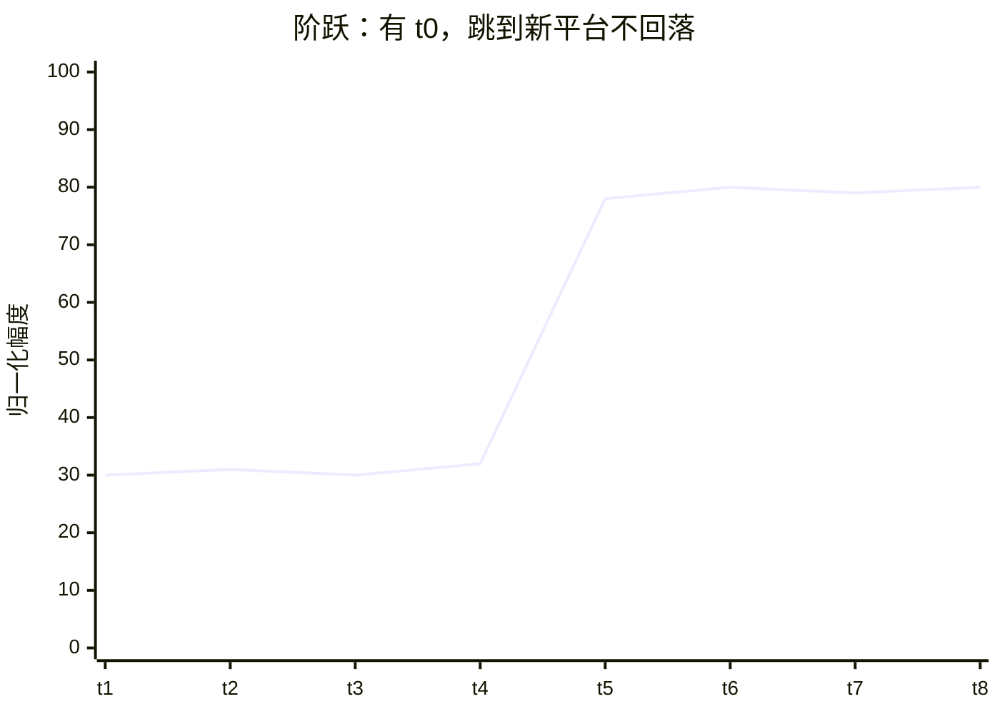
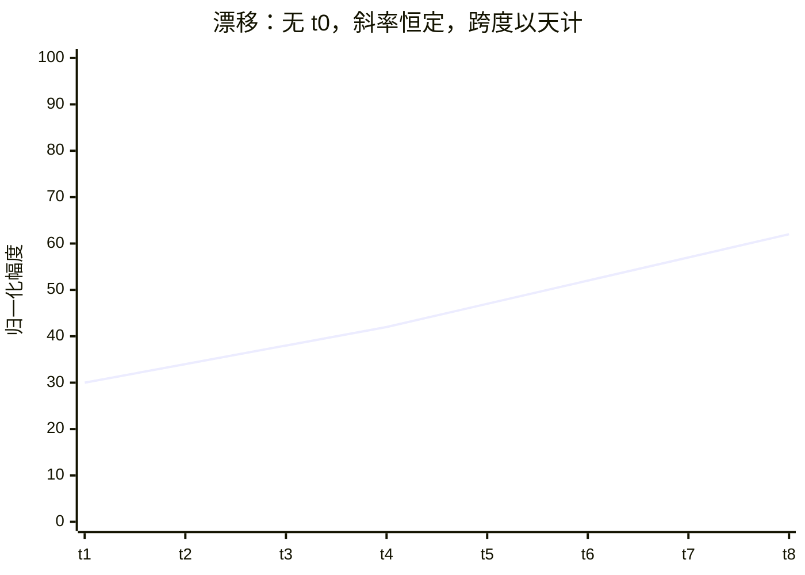
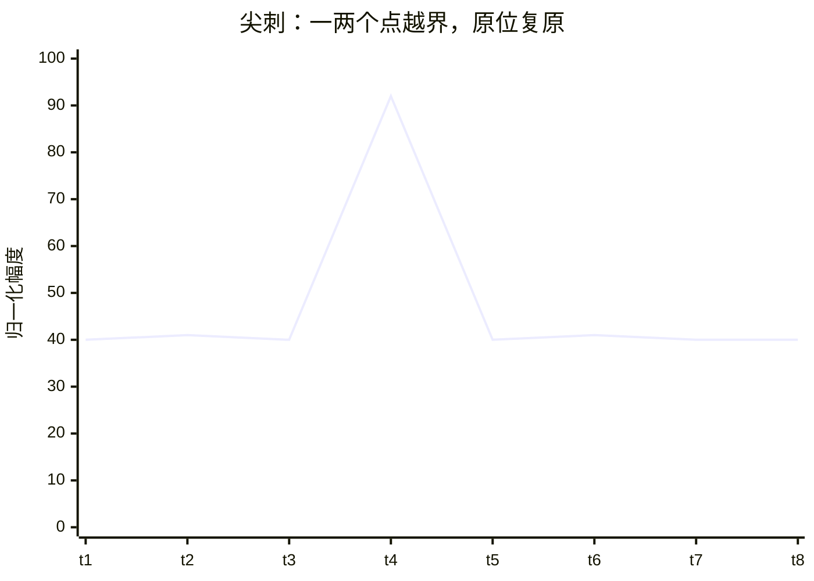
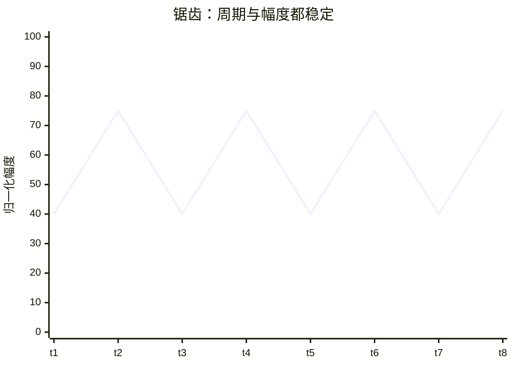

上一课把静态阈值否定掉了，这一课换判据：不看数值越不越线，看曲线长成什么形状。

## 五种形态，指纹比阈值好用

阈值只答一个是/否的问题：越线没有。它答不出「这是什么」。

同样一条 6.4 Gbit/s 的平线，可能是扩容后的新常态，可能是光衰前的最后一晚，也可能是换了采集源造出来的假象。三种情况三种动作，阈值一个都给不出来。

形态是曲线的形状特征，五类，每类背后是一族固定根因，所以能直接指方向。判定不靠算法，靠三件事：历史拉得够长、元数据跟得上、t0 找得准。









第五种形态是缺失：整段空白，记录的是无值，零值另有一层含义。它画不成曲线，判据也不在曲线里。

| 形态 | 指纹 | 常见根因 | 下一步 |
|---|---|---|---|
| 阶跃 | 有 t0，新稳态不回落 | 变更、换采集源、计数器清零、路由切换 | 拿 t0 查变更单与 `source` 标签 |
| 漂移 | 无 t0，斜率恒定 | 光模块老化、误码缓增、内存泄漏、会话缓增 | 拉 30 天斜率，同型号横向比 |
| 尖刺 | 单点越界，下点复原 | 计数器回绕或重置、抓取超时、备份与扫描 | 先排采集侧，再找业务事件 |
| 锯齿 | 周期与幅度双稳定 | 定时任务、拥塞窗口、ECMP 摆动、采样拍频 | 量周期，对定时任务表 |
| 缺失 | 整段无值 | 采集器失联、模板缺失、设备重启 | 走缺失判据三连 |

第五行是唯一不产生告警的一行。引擎默认跳过空值评估，「没有数据」和「没有异常」在面板上长得一模一样（第 22 课）。

## 前四种：一种形态一个查法

**阶跃先找 t0。** 有 t0 说明那一刻有人或某个协议改了状态，自然演化留不下 t0。拿 t0 去三处查：变更单、采集配置（`source` 从 `snmp` 换成 `gnmi`，第 19 课）、设备启动记录（`sysUpTime` 归零）。

阶跃最容易误判成容量增长。曲线上一级一级抬，人看一眼说「业务涨了」，顺手写进扩容预算。真相是 11:00 一条路由收敛，邻居口一半流量转了过来，扩容算多一倍。第 36 课要求 `source` 与 `sampled_by` 进标签，实际价值就在这里：换源造成的阶跃，标签里看不出来，就得去查一个根本不存在的流量事件。

还有个变体：抬上去待一阵又落回来。待的时间短于采样周期，它在曲线上就是尖刺；待几个小时，它是两个阶跃。判据落在持续时长与 t0 是否成对上，曲线形状只是旁证——成对且时长能对上一次演练或一次迁移，按计划事件走；只抬不落，才去找永久性的原因。

**漂移只看斜率。** 它没有 t0，单看一天完全正常，拉一个月才发现起点 2.0 Gbit/s、现在 2.6 Gbit/s。

做法是把窗口拉到 30 天以上算斜率，再做横向比对：同型号、同批次、同位置的端口一起画。第 04 课拿 -30.2 dBm 跟同型号其余 11 个模块的 -6 至 -8 dBm 比，就是这一手。

代价常出在留存上。收光从 -7 掉到 -10 没人管，掉到 -14 的门限，端口一夜全红。报警长成阶跃，根因是三个月的漂移，而那段历史早被 7 天留存策略删了。第 35 课的三层留存里，1 分钟聚合留一年，正是为这一类准备的。

**尖刺先怀疑采集。** 单点翻三倍，本能是查链路，九成的尖刺在采集侧。

三个固定来源：32 位计数器回绕（4.29e9，第 18 课）、设备重启后计数归零、抓取超时把一次间隔拉成两倍再跳回。判据都是看相邻点的时间戳差，以及 `sysUpTime` 有没有归零。

排掉采集侧，剩下的尖刺都有业务含义：备份窗口、批量扫描、某批机器同时登录。共同点是持续时间短于采样周期，你能看到的只是一个被平均过的凸起。

误判的代价是方向全错。去查误码和光功率，两小时过去什么都没查到，而答案在采集器日志里。

还有一笔账在第 39 课付：尖刺一天出现一两次，动态基线会把峰值区间学成正常带宽，之后真故障落在那个宽区间里，一声不响。省下几条误报，换来一次没响的报警。

**锯齿量周期，别量幅度。** 周期稳定说明有个定时器在驱动：cron 备份、OSPF 定期泛洪、TCP 拥塞窗口在丢包后的锯齿回升、ECMP 两条路径的流量在 hash 扰动时来回摆。

有一类锯齿是假的：采样拍频。真实周期 61 秒、采样周期 60 秒，两个频率拍出 61 分钟的慢波，这个波在物理上不存在。判据是把采样周期改一倍——波还在、周期跟着变，就是拍频。

周期别靠眼睛量。取相邻峰值的时间差，求中位数，再看这些间隔的离散度：中位数稳定而离散度小于 5%，是定时器；离散度大，是拥塞窗口那类自激振荡，驱动源在链路本身。

误判成设备 flapping 很常见。端口抖动按窗口内变化次数判（第 05 课），流量锯齿去查 flapping，半天之后发现是备份任务。

## 缺失：唯一不报警的形态

一条流量曲线断了一段，两种可能：采集侧瞎了，或者真的没流量。两种结论在复盘里差一个数量级，曲线长得一模一样。

三个判据，按便宜程度排：

1. **同源其他设备。** 一个采集器管 200 台，只断这一台 → 问题在设备或到设备的路径；200 台同时断 → 问题在采集器、它所在的主机，或中间那条管理网链路。这一条一秒看完，先做。
2. **上一轮成功时间。** 库里存 `last_success_ts`，不存「是否在线」。断在哪一秒、断了多久，要靠时间戳算出来，「当前状态」答不了。
3. **设备侧自证。** 管理面可达、`sysUpTime` 连续增长、接口计数器在涨 → 设备活着，问题在采集链路：ACL 改了、凭据过期、订阅被目标踢掉（第 19 课）、流模板缺失（第 22 课）。反过来 `sysUpTime` 归零 → 设备重启过，这段时间真的没数据。

三连走完还剩一种：设备活着、采集正常、计数器一个字节没涨。这时的空是真的空，链路没有业务，不该报故障，但心跳本身仍要报出来（第 22 课那条反直觉的用法）。

最坏的情况是把它读成「正常」。引擎跳过空值，大盘一片绿，值班的人以为夜里没事。第 02 课那个单向口被埋了四天，走的同一条路：没有一条规则因为缺少数据而响。

落库形态要写死。缺的那一格存 NULL 并打标记，不插值、不沿用旧值、不写 0：

```text
14:00  device=d4  port=ge-0/0/12  metric=out_bps  value=NULL  flags=gap
```

`flags=gap` 是给三个下游读的：告警引擎见到它跳过评估但记一条缺口，举证接口见到它把这段时间标成「不可用」，容量报表见到它把分母减掉。三处只要有一处把 NULL 读成 0，一段采集故障就变成一脚流量跌零。

缺口阈值按采集周期定：连续 3 个周期无值算缺失并标 gap，掉 1 个周期只算抖动，不标也不报警。

## 微突发：200 毫秒打满，60 秒采样看不见

一个 25G 上行口，出口队列 256 KB，平均包长 1000 字节。

```text
出口速率     25 Gbit/s ÷ 8            = 3.125 GB/s
队列排空     256,000 B ÷ 3.125e9 B/s  = 82 µs
到达 1.05 倍线速 → 净积压               = 156 MB/s
队列填满     256,000 B ÷ 156e6 B/s    = 1.6 ms
持续 200 ms → 溢出 156 MB/s × 0.2 s   = 31.25 MB ≈ 31,250 个包
60 秒通过量  3.125 GB/s × 60 ÷ 1000 B = 1.875 亿包
丢包率       31,250 ÷ 1.875 亿         = 0.0167%
```

到达速率只超出口 5%，1.6 毫秒就填满队列，之后 198 毫秒全部尾丢；突发一停，队列 82 µs 排空，回到基线。丢掉的包没出去，所以那 60 秒的字节增量只少 0.0167%，速率曲线一格不动；丢包率 0.0167%，离任何阈值都远。丢弃计数会跳 31,250，数字看得见，形状看不见。

p99 看得见。队列排空要 82 µs，这一瞬间的排队时延就是 82 µs，基线 p99 若在 80 µs，落在 162 µs——翻倍。探针间隔 100 ms 时，200 毫秒的突发必然打中两个探测包，这一分钟的 p99 由这两个包决定。**均值把突发抹平，分位不抹。**

先确认手里这条 p99 是怎么算的。探测包算的、应用侧 RT 算的、设备侧队列时延算的，三个数的分子分母全不同（第 36 课）。微突发在第一个上翻倍，在第二个上可能只抬五个点，在第三个上是直接证据。口径没统一之前，形态判不准。

要采多细才看得见？每天一次这样的突发，落在哪个 60 秒窗口不确定，命中概率就是事件时长比采样周期：

```text
60 s 采样   0.2 ÷ 60  = 0.33%   → 约 300 天撞上一次
1 s  采样   0.2 ÷ 1   = 20%     → 约 5 天一次
100 ms 采样 0.2 ÷ 0.1 = 200%    → 必然命中两个点
```

结论不好听：60 秒采样三百天才碰上一次，把周期压到 1 秒也只有两成。**这类故障靠提频救不回来**，只有两条路——采队列深度，或者不采样、采累加量。队列深度在 SNMP 里没有标准 OID，得走 gNMI 的 `/interfaces/interface[...]/state` 系路径，覆盖率还只有两三成（第 19 课）。累加量是出口丢弃计数、队列入队超阈计数、ECN 标记计数，200 毫秒的突发照样加得进去。

排查顺序也由此定：先拿 p99 与队列深度定位到那一分钟，再用 `discards` 的 60 秒增量对齐到那 60 秒，最后看有没有 ECN 标记，它与丢弃分开统计。三段数据分辨率不同，对不上是常态。

加大队列是个陷阱。256 KB 抬到 2 MB，1.6 毫秒的填满时间变成 13 毫秒，丢包少了，排队时延上限从 82 µs 抬到 640 µs——p99 的坏值没消失，只是从「丢包」换成了「慢」，时延也更长。这条路往前走一步就是 bufferbloat：曲线越来越平，时延越来越高，60 秒采样比原来更看不出所以然。

## 判据

四段曲线，判形态，说下一步拉什么。

```text
A  10:00–10:41 速率 3.1–3.4 Gbit/s；10:42 起稳定 6.4 Gbit/s，到 11:30 未回落
B  12:00–18:00 速率 4.0 → 5.5 → 7.2 Gbit/s 单调上行，无突变点；同期收光 -7.1 → -9.8 dBm
C  14:00–14:05 速率无值；同一采集器下另 199 台数据完整；该设备管理 IP 可达，sysUpTime 连续
D  每天 02:00–02:08 抬 40%，连续 19 天，幅度偏差小于 3%
```

验收三条：

1. 每条判出形态，指出判据落在哪个字段上
2. 每条写下一步拉什么数据，具体到表、字段或接口
3. 指出哪一条最容易被误判成故障，误判之后浪费掉的是什么

::: details 参考

**A → 阶跃。** 判据是有明确 t0 且不回落。下一步：拉 t0 前后 5 分钟的 `source` 与 `sampled_by` 标签、变更单、`sysUpTime`。三处都干净，才去查路由与流量迁移。

**B → 漂移。** 判据是无 t0、斜率恒定、持续 6 小时。下一步：拉 30 天收光与 `dot3StatsSymbolErrors`，同型号横向比，看是不是单颗模块在劣化（第 04 课）。

**C → 缺失，且在采集侧。** 判据是「同源其他设备正常」加「设备侧自证活着」两条同时成立。下一步：查该设备的采集任务是否还在跑、ACL 与凭据、订阅是否被踢（第 19 课）。这段补不回来，标 gap。

**D → 锯齿。** 判据是周期与幅度双稳定，偏差 3% 说明驱动源是定时器。下一步：对定时任务表，先查 02:00 的备份与大文件传输。误判成容量增长，会被写进下一季度的采购单。

最容易误判成故障的是 B：它报警最晚，报出来时像阶跃，人一去查当晚的变更什么都没查到，然后记一笔「原因不明」。真正的六小时数据就在库里，没人往回拉。

:::

## 小结

五种形态五种下一步。阶跃找 t0，漂移看斜率，尖刺先怀疑采集，锯齿量周期，缺失走三连。

缺失是唯一不报警的那种，判据不在曲线里，在元数据里：同源其他设备、上一轮成功时间、设备侧自证。三样缺一样，你就会把一段采集故障读成一夜平安，而复盘会上没人能证明那晚真的没事。

微突发的证据也不在采样点里。超 5% 就能在 1.6 毫秒填满 256 KB 队列，200 毫秒的过载只丢下 0.0167% 的包，60 秒曲线纹丝不动，命中概率 0.33%。均值抹平它，p99 和队列深度留住了它，累加量记得住它。

下一课换方向：形状判出来之后，人手上该拿哪把工具。

## 配套实验

本课无实验。五种形态的判读靠曲线，21 个实验里没有一个能画曲线。`labs/14-alert` 里那条 24 分钟缓慢爬升的漂移可以当反例：三条规则全漏，而人眼一看就知道是漂移。

## 思考

1. 你平台上「上一轮成功时间」是可查字段，还是只有「当前在线」一个布尔？这两者对断了 4 小时和断了 40 秒的处置差别在哪？
2. 把队列从 256 KB 加到 2 MB，微突发的丢包会消失吗？p99 会怎么变，代价落在谁身上？
3. 采样周期压到 100 ms 之后，撞上的是噪声还是信号？你怎么把拍频和真周期分开？
