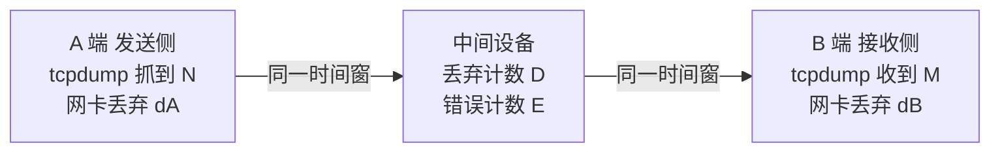

上一课把抓包排在成本表的第五位，这一课说清它为什么值那个价：它是唯一能让你看见「包长什么样」的工具，也是唯一会自己把故障做大的工具。

## 先定要证明哪句话，再写过滤器

最常见的顺序是先抓五分钟全量，再回来翻。三百兆 pcap 打开，一个个包点过去，一小时过去，什么都没定下来。

反过来做：先写下要证明的那一句话，再把它翻译成表达式。四句话覆盖八成工单。

| 要证明的 | 过滤表达式 | 抓多少 |
|---|---|---|
| 这条 TCP 到底建没建起来 | `tcp and host 10.32.7.18 and port 3306` | `-c 40`，握手前后就够 |
| 包有没有到这台机器 | `host 10.32.7.18`，两端同时抓 | 同一时间窗，30 秒 |
| SYN 发出去有没有回 | `tcp[tcpflags] & tcp-syn != 0 and host 10.32.7.18` | 60 秒，够看清重传节奏 |
| 谁先把连接拆了 | `tcp[tcpflags] & (tcp-rst|tcp-fin) != 0` | 到第一次拆链为止 |

四个开关决定你抓的东西能不能当证据：

- `-nn`：不反解主机名与端口名。反解要发 DNS 查询，高包量下会把抓包卡住，顺手在流量里制造一批你没打算抓的包
- `-s 96`：只存前 96 字节。以太头 14 + IP 头 20 + TCP 头 20 = 54，剩下 42 字节装得下 TCP 选项（时间戳、SACK、窗口缩放），够判重传与 RTT
- `-w` 落盘，别在终端读。终端打印会把包丢掉，落盘的 pcap 可以反复用不同过滤器重看，也能留作证据
- `-i any` 在 Linux 上抓到的是 cooked 帧（SLL），看不到以太头，MAC 地址、VLAN 优先级都减一档信息。要看二层就指定真实接口名

## 三个模板：两端各抓一次，然后离线判

模板一，按主机与端口只抓头，落盘并按时间切片：

```bash
sudo tcpdump -i eth1 -nn -s 96 \
  -w '/tmp/cap-%Y%m%d-%H%M%S.pcap' -G 60 -W 3 \
  'host 10.32.7.18 and (tcp port 3306 or icmp)'
```

`-G 60` 每分钟切一个文件，`-W 3` 只保留三个，超出就覆盖最老的。这条命令跑一小时也不会把盘写满，代价是最早那 57 分钟的数据没了——取证导向的抓包要反过来，先算清容量再定参数。

模板二，两端同抓。时间对齐靠同一个 NTP 源，起止时刻写进工单：

```bash
# A 端（发送侧）
sudo timeout 30 tcpdump -i eth1 -nn -s 96 -w /tmp/a.pcap \
  'host 10.32.7.18 and tcp port 3306'
# B 端（接收侧），同一个 30 秒窗口内执行
sudo timeout 30 tcpdump -i eth1 -nn -s 96 -w /tmp/b.pcap \
  'host 10.32.7.18 and tcp port 3306'
```

模板三，离线分析。`-r` 读盘，`-Y` 用显示过滤器，比重新抓一遍快两个数量级：

```bash
# 数 SYN：发出去了多少条新建
tshark -r /tmp/a.pcap -Y 'tcp.flags.syn==1 && tcp.flags.ack==0' \
  -T fields -e frame.time_epoch -e ip.src -e tcp.dstport | wc -l

# 按秒看重传：定位到具体哪一秒
tshark -r /tmp/a.pcap -q -z io,stat,1,'COUNT(tcp.analysis.retransmission)tcp.analysis.retransmission'
```

第二条的输出长这样（字段名固定，数值随样本变）：

```text
| Interval | Frames | Bytes  | COUNT(tcp.analysis.retransmission) |
| 0 <> 1   |  1,842 | 1.1 MB |   0                                |
| 1 <> 2   |  9,741 | 5.8 MB | 137                                |
| 2 <> 3   |  9,806 | 5.9 MB |   2                                |
```

判读只看两件事：重传集中在哪一秒，以及那一秒的包量是不是也翻了五倍。137 ÷ 9,741 = 1.4% 的重传落在单一秒里，前后两秒都是 0.02% 量级——这是瞬时拥塞或丢包，持续的坏链路给不出这种形状。包量与重传同时翻倍的那一秒，通常就是微突发打满队列的那 200 毫秒（第 40 课）。

只看 `Frames` 会错过它。按这次抓包的 9,800 pps 摊到 60 秒是 58.8 万个包，137 个重传占 0.023%，任何 60 秒均值都看不见。

## 一个包丢在哪：三处对照

抓包最大的误用是只抓一侧。只抓一侧，你只能证明「本端没收到」，不能证明包没到过。



三个数缺一处就不叫证据链，取数必须落在同一个时间窗口里。三处的数是 N、D/E、M，判读靠它们的差值，不靠绝对值：

| 观测 | 结论 | 还要补什么 |
|---|---|---|
| N = M，应用说没收到 | 包进了主机，丢在主机内部 | `ethtool -S` 的 `rx_dropped`、`ss` 的 `Recv-Q`（第 44 课） |
| N > M，D 的增量 ≈ N − M | 中间设备出方向队列丢弃 | 队列深度与瞬时速率，微突发（第 40 课） |
| N > M，D 不动，E 在涨 | 中间设备入方向错误 | 光功率与误码（第 06 课） |
| N > M，D 与 E 都不动 | 抓包点没覆盖真实路径 | 换抓包点；ECMP 走了另一条分支（第 12 课） |
| dA 或 dB 在涨 | 抓包自己和网卡在丢 | 先修观测手段，这组数作废 |

第三行最容易误读。设备入方向错误计数涨，说明帧到了物理层但校验失败，这类丢包在抓包里表现为「源头发了、目的地没有、中间没有队列丢弃」——只看丢弃计数会以为是路径问题。

差值的量级也要算。0.3% 的丢包在 10,000 个包里是 30 个，而一次运行不当的抓包自己就能丢几百个。判断「这 30 个是链路丢的还是抓包丢的」，唯一的办法是看抓包进程自己的统计（下一节）。样本量压不到 1,000 个包以上，这点差值说明不了任何问题。

## 抓包自己会把问题变大

三件事，每件都能让观测动作变成新故障。

**打满 CPU。** BPF 过滤在内核里跑，代价很小；把包拷到用户态、写盘，代价全在这里。高包量口上 `tcpdump` 跟不上，退出时打印一句 `1234 packets dropped by kernel`。这个数字证明的是这次抓包不完整，不能当链路丢包的证据。看到它，前面的结论一律重来，先收窄过滤器、加 `-s 96`、加 `-c`。

**写满磁盘。** 只抓头也挡不住量。按每包 96 字节载荷加 16 字节 pcap 记录头算：

```text
200,000 pps × 112 B          = 22.4 MB/s → 80.6 GB/小时
1 Gbit/s 线速 64 B 小包       = 1.488 Mpps × 112 B = 166 MB/s → 600 GB/小时
```

一块 500 GB 的盘，按 600 GB/小时写，50 分钟就满。抓包目录绝不能放在系统盘，也不能和业务共用一块盘——写满 `/var` 会让同机的服务一起挂。参数上给三重限制：`-G` 限时长、`-W` 限文件数、`-C` 限单文件大小。

**带走业务数据。** `-s 96` 只能保证不落应用载荷，头部里的 IP、端口、TLS 的 SNI 已经是敏感信息；短报文和明文协议的前几十字节照样是业务内容。所以 pcap 要按敏感数据处理：接口白名单、时长不超 30 分钟、目录权限限到执行人、事后删除并留删除记录。平台化的抓包任务要把这四条写进参数，执行人自觉靠不住。

另有一类假象每次都要解释，它跟抓包本身无关：**offload 造成的假分段**。开着 TSO/GSO 时，发送方向你抓到的是内核交下来的大块数据，长度能到 64 KB，远超 MTU；接收方向 GRO 又会把小包合并成一个大包。你数包数、量 MSS，得到的都与线上真实的分段对不上。判据很直接：抓到的单包长度大于 MTU，或者 MSS 跟对端通告的不一致。配套实验 `16-capture` 的样本里埋了这一类。处理办法是在抓包机上对抓包网卡关掉 offload（`ethtool -K eth1 tso off gro off`），或者干脆承认这组包只能看头部字段、不能数包数（第 44 课）。

## 判据

三段记录，各判「丢在哪一段」，并指出哪一处数据是判据、哪一处只是旁证。

```text
A 发送端抓 48,200 个包；接收端抓 48,050；中间设备 input errors +0，output discards +0
B 发送端抓 12,000 个包；接收端抓 11,900；中间设备 output discards +100
C 两端各抓 50,000 个包，N = M；应用侧 ss -ti 显示同一连接重传持续增长
```

验收三条：

1. 每条指出丢包发生在哪一段，判据是哪一个数
2. 每条给出下一步动作，具体到命令
3. 自己补一条「三处对不上」的记录，说明为什么会这样

::: details 参考

A → 差值 150 个包，设备侧计数器一个没动。两条可能：抓包点没覆盖真实路径（ECMP 走了另一分支），或抓包自己丢了包。判据是先看抓包进程的 `packets dropped by kernel`——它不为零，「150」这组数就作废。旁证是同期的端口计数增量，它能给出这一分钟到底发了多少包。

B → 差值 100，与 output discards 的增量正好对上。丢在中间设备出口队列，属拥塞类。下一步取队列深度与瞬时速率，对齐到那一秒，看是不是微突发（第 40 课）。

C → 两端都收到了包，N = M，故障在主机内部。判据是 `ss -ti` 的重传计数与应用表现一致；下一步查 `rx_dropped`、`rx_missed_errors` 与 ring buffer 大小（第 44 课）。

对不上的那种，通常是 offload 假分段：两端数出来的包数差一个整数倍，单包长度还超过 MTU。

:::

## 小结

抓包的价值在过滤器设计和三处对照，不在语法。四句话对应四种过滤器，`-nn`、`-s 96`、`-w`、指定接口四个开关决定这组数据能不能当证据。

一个包丢在哪，要三个数：发送端抓到多少、中间设备丢了多少、接收端收到多少。缺一处，你只能证明自己没看见。

抓包会自己制造故障——打满 CPU、写满磁盘、带走业务数据，还会在被 offload 改写过的分段上骗你一次。看到 `packets dropped by kernel`，前面的结论全部重来。

下一课把「路径」这一类工具摊开：traceroute、mtr、paris 三者的分歧点，以及 ECMP 下那条永远不连贯的路径。

## 配套实验

[`labs/16-capture`](https://github.com/lerixhe/idc-network-observability/tree/main/labs/16-capture) —— 三端对照指认丢包段。样本埋了 ring buffer 溢出、offload 造成的假分段、ICMP 限速三类陷阱。

## 思考

1. 你手上那次抓包，抓包点覆盖了真实路径吗？如果 ECMP 把它分到了另一条分支，你看到的是什么？
2. 为什么 `-s 96` 在大多数工单里够用，什么场景下必须全包长？全包长要付什么代价？
3. 用户抱怨「连接被重置」，两端抓包都没有 RST，中间设备也没有重置计数——还有哪些可能没查？
