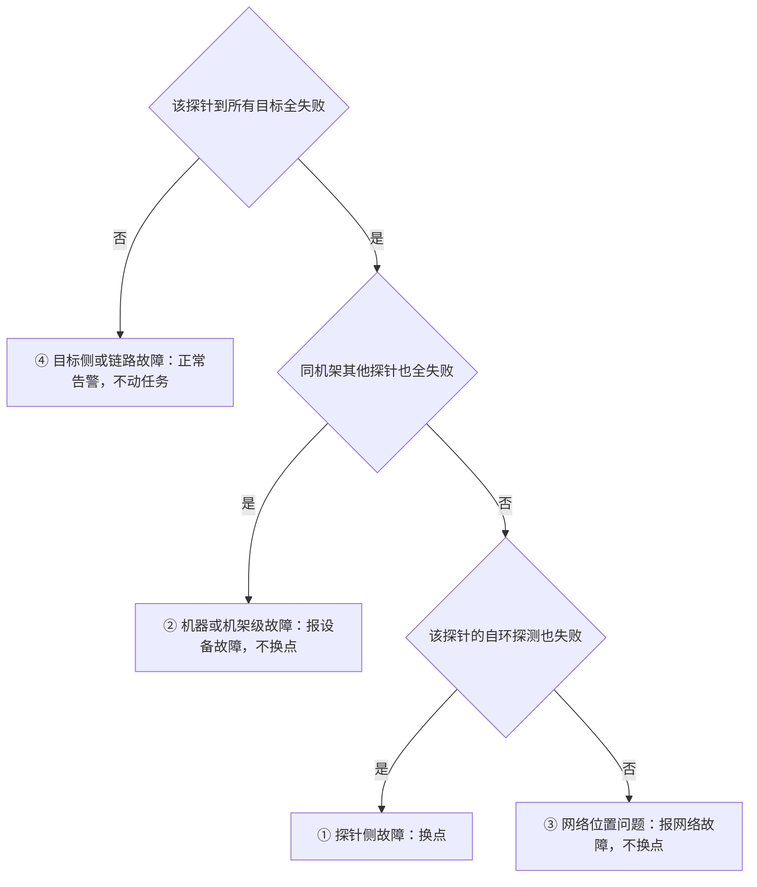

## 每分钟都在变的现场

这个平台有一个不显眼但吃掉最多人力的部分：任务集。

十万个探针，每个探针手上三到五个探测任务，合起来三十八万条（388,096）。现场每天变：三千台机器上下线、四百条链路改配、几百台换板卡、几十个机架扩容。每一次变化都要翻译成「哪些探针的任务集要改」。

最笨的做法是全量重推：任务变了，通知所有探针重新拉一遍。这个做法在第一个月就把控制面打坏过一次——三十秒内两万 QPS，每个请求都要走完整的任务解析，控制面 CPU 打满，探针侧也开始超时。

那是 02 课交接班那一栏里的事：「昨夜看着不对但没报警」的东西，在这里变成了「控制面被打坏，探测还在跑，所以没人立刻知道」。

## 三个候选

| 方案 | 收敛速度 | 控制面成本 | 失效方式 |
|---|---|---|---|
| 全量重推 | 立刻 | 每次变更 = 十万次全量响应 | 变更一多就打坏 |
| 版本号 + 差量 | 一个拉取周期（5 秒） | 未变更时响应体 20 字节 | 版本号管理错误会让探针永远拿旧任务 |
| 按探针分区差分 | 分区内立刻 | 控制面多一层分区路由 | 分区边界上的变更要跨区协调 |

选版本号 + 差量。它的失效方式最容易发现：探针拿不到新任务会一直报旧版本号，控制面能看到「有 37 个探针停在 v4491」；全量重推的失效方式是整个控制面不响应，你只能看到「全都坏了」，不知道从哪修。

## 一分钟是怎么卡出来的

目标是「任务集变更一分钟内收敛到所有探针」。这个数由三个环节相加得出：

```text
拉取周期        5 秒   探针每 5 秒问一次「我的版本变了吗」
两级缓存        3 秒   区域缓存节点命中率 94%，未命中回源
差量编码        2 秒   变更任务集重新编码，增量包平均 380 字节

最坏路径        5 + 3 + 2 = 10 秒
实测 P99        38 秒（十万探针的长尾来自重连与退避）
```

一分钟的余量留给最坏情况：控制面发版重启、区域缓存击穿、某个机架网络抖动。**余量给「一分钟」这个承诺留出兑现空间。**

代价写清：控制面要维护一棵任务版本树。每个探针的版本号、每个版本的差量包、每个版本的生命周期（保留 7 天供补拉）。这棵树在第六个月涨到 3.7 万个版本节点，占用 1.2 GB 内存——不大，但它是一个必须存在的额外结构。

## 任务集长什么样

一条任务五个字段：

| 字段 | 内容 | 说明 |
|---|---|---|
| `task_id` | 链路 ID + 方向（`L-1043:fw`） | 可推导，不用自增 |
| `target` | 对端 IP | |
| `period` | 探测周期（5 / 15 / 30 秒） | 分档规则见第 50 课 |
| `port_budget` | 端口段起点与长度 | 第 50 课的预算 |
| `probe_id` | 承担它的探针 | |

第一行那个「可推导」很关键。初期用了自增 ID，第二次机架扩容时全部重算，2 万条任务的 ID 全变了——控制面看到的是「删了 2 万条、新增 2 万条」，触发了全量重推，当场把控制面打掉半条命。

改成从链路 ID 推导之后，重算不会产生新 ID：L-1043 的顺向任务永远叫 `L-1043:fw`，不管它落在哪台探针、哪个版本里。代价是 task_id 不能再编码变更信息，变更要靠版本号表达。

这条经验可以搬走：**任何要跨系统引用的标识，都不要用自增。** 告警、工单、举证包都要引任务，一个会变的 ID 意味着每改一次都得追改下游。

## 坏点三段判定

探针会坏：机器关机、被重装系统、网卡换掉、agent 进程被安全软件杀掉。彻底不发包是坏点的常态，偶尔超时还算好的。

一个坏点最直接的后果是那一片的链路在平台上全部变成盲区。一个探针管四条链路，它一坏就是四条链路没有数据；一片机架的探针同时坏掉，就是几十条。

问题在于「这个探针没数据」有四种原因：

| 现象 | 真因 | 该做什么 |
|---|---|---|
| 该探针到所有目标全失败 | 探针侧故障 | 换点 |
| 该探针到所有目标全失败，且同机架其他探针也全失败 | 机器或机架级故障 | 不换点，报设备故障 |
| 该探针到所有目标全失败，但其他探针到这些目标正常 | 该机器的网络位置有问题 | 报网络故障，不换点 |
| 该探针到部分目标失败 | 目标侧或链路故障 | 正常告警，不动任务 |

判定靠两问：

- 问一：这个探针到其他目标也全失败吗？它分出「探针侧」与「目标侧」
- 问二：同机架其他探针正常吗？它分出「单点故障」与「环境故障」

两问落到四格，探针侧故障与网络位置问题的区分再借一条自环探测（第 14 课的健康评分里就有这一维）：



只有 ① 那一格换点。这个判定写起来简单，实施时第一个月的误判率是 43%——原因是问二依赖「同机架其他探针」，而单机架只有两台探针的场景下，另一台也刚好在升级，两问都答成了「全失败」，于是判成「环境故障」，实际是两个探针同时坏了。

补的办法是加一层时间窗：**同一机架内所有探针在同一分钟内全失败，先按环境故障处理，超过 3 分钟才重新判定。** 三分钟的依据是设备重启窗口的下界——短于这个时间的变化，分不清是探针坏了还是机器在重启。

## 对账：任务集和拓扑得对得上

增量下发的正确性建立在一个前提上：任务集是从拓扑算出来的。拓扑错了，任务就算得再准也是在探错东西。

所以每周跑一次对账，比三样：

| 对账项 | 数据源 | 不一致时 |
|---|---|---|
| 应探链路数 | 拓扑（链路表） | 任务集里少一条 → 覆盖率无声下滑 |
| 链路两端是否在管 | CMDB 生命周期 | 对端已下线但任务还在 → 探针白跑一个月 |
| 端口段预算 | 链路等价路径数 | 带宽升级后未重算 → 覆盖冗余浪费 |

第二个月对出过一次：一条跨机房专线的对端设备已经拆了两个月，任务还在跑，探针每天对着一台不存在的设备发 17,280 个包。它不产生错误数据，只产生噪声——每个周期的全失败被记成了链路故障，每个月 200 多条无效告警。

这类噪声很难在告警侧滤掉，它长得和真故障一模一样。唯一的治法在对账这一层：**拓扑变了，任务要跟着变。**

## 震荡抑制

换点之后还有一层问题：新探针可能也坏。

第一次遇到是三台探针连续被换到一个有问题的位置：第一台因为内核升级丢了 ICMP 权限，被判定为坏点；任务换到第二台，第二台的目标列表里有一个不可达的旧地址，探测全失败，又被判定为坏点；换到第三台，第三台刚被重装，任务还在下载。

一小时内同一个任务在三台机器之间迁移了五次，每次迁移断 10 秒数据（一个拉取周期加一个探测周期）。运维那边看到的是六分钟里有五分钟的曲线是断的。

抑制规则：**同一个任务连续被换三次之后，停止换点，转为报故障。**

| 换点次数 | 动作 |
|---|---|
| 1 | 正常替换，记一次 |
| 2 | 正常替换，同时把前两个探针拉进观察名单 |
| 3 | 停止替换，产生一条「任务无可用探针」告警，交人工 |

人工介入的成本比自动替换高一个数量级，换来的一件事是：**系统不再自己制造震荡**。自动化的价值在「处理常见情况」，覆盖所有情况不是它的任务。

还有一条配套：换点后的新探针要有一个 60 秒的观察期，观察期内失败不判定为坏点——给它时间把任务拉下来、把第一个探测周期跑完。没有这个观察期，新探针几乎必然被判成坏点，因为任务还没到手它就「全失败」了。

## 三个月后：版本树的两个边界失效

**一、差量编码在「任务集大改」时失效。** 某个业务线整体迁移，涉及 4000 台机器的任务重排。差量包从 380 字节涨到 12 KB，控制面编码耗时从 2 秒涨到 40 秒，一分钟收敛的承诺当场破功。

处理办法是给差量加一个上限：变更超过阈值（任务数 10%）时退回全量推送。全量推送慢而可预测，差量快而可能炸穿——两种模式都要有，选择依据是变更规模。

**二、版本树的生命周期管理被忽略。** 保留 7 天供补拉，实际有探针离线 11 天后回来，要求的版本已经删了，它只能全量重拉——那时正好赶上控制面发版，两件事叠在一起，那一批 200 台探针停了 40 分钟。

补的办法是给离线探针一个明确的降级路径：版本不存在时，回退到「最近可用版本 + 全量」，并且这条路径要单独限流，避免集中回来时打坏控制面。

这两个边界失效指向同一个教训：**版本号机制假设「变更总比初装小」，现实里的变更可能比初装还大。** 工程上只要一个数就能防住这类事：变更率监控。每次下发把变更比例记一笔，超过 10% 单独告警。同一个假设在后面的数据库迁移、控制台发布里反复出现。

## 复盘

这一课的三件事——增量、坏点、震荡——指向同一个判断：**自动化的边界在震荡这一侧。**

增量下发、坏点判定都是纯技术问题，做对了就稳定。震荡抑制属于另一类：它要求系统承认「我可能判错了」，然后停下来交给人。这个停下来很反直觉，工程直觉通常是「继续重试直到成功」。在任务迁移这件事上，继续重试的代价是把一个局部故障放大成一片数据断流。

一条可以直接搬走的经验：**凡是「替换、迁移、重派」类的自动化，都要有一个「换 N 次就停」的闸。** 52 课的健康评分阈值、54 课的告警抑制，都是同一个形状的东西——自动化系统需要一个「我认输」的出口。

## 判据

给你的任务集设计一版增量方案：

1. 十万探针、每探针 4 个任务、每天 3000 台机器变化，算出全量重推与差量下发的每日响应字节数
2. 把「一分钟收敛」拆成环节耗时，标出你的最坏路径
3. 写坏点判定的判定树，每一格给一个真实场景
4. 定震荡抑制的阈值（换几次停），并说清取 5 次会付出什么代价

::: details 参考

答案：第 1 问两个数都算出来，量级差两个以上；第 2 问的最坏路径能对应到工程环节；第 3 问四格都有场景；第 4 问的阈值有依据（断流时长乘次数，与人工介入成本相比）。

:::

## 小结

任务分发的核心是增量：版本号 + 差量，一分钟收敛靠 5 秒拉取、两级缓存、2 秒编码三段相加，余量留给最坏情况。

坏点判定靠两问四格，只有「自己全挂、别人都好、自环也断」才换点。第一个月 43% 的误判来自「同机架另一台也在升级」，补的是时间窗。

震荡抑制是这一课最值钱的一条：换三次就停，转人工。自动化的边界在震荡这一侧。

下一课讲这套系统最容易被外部挑战的一面：探针是装在别人机器上的程序，一次配置错误就能把机房出口打满。

## 配套实验

[`labs/19-task-increment`](https://github.com/lerixhe/idc-network-observability/tree/main/labs/19-task-increment) —— 增量比全量少 21.7 倍的下发量、坏点两问四格、换三次就停的震荡抑制。实验把每探针的任务数放大到 30 条、探针数固定 10 万，让差量与全量的字节比更醒目；比值与真实规模无关。

## 思考

1. 你的场景里，「一分钟收敛」应该拆成几段？哪一段最可能成为长尾？
2. 坏点判定的两问在你这里有足够的对照组吗？如果单机架只有一台探针，怎么办？
3. 「换三次就停」的闸装在哪个组件里？装错位置会有什么后果？
